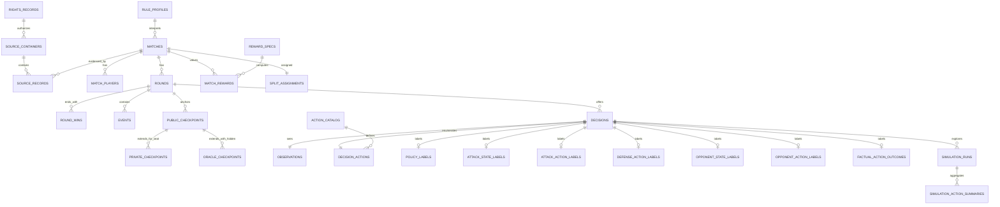
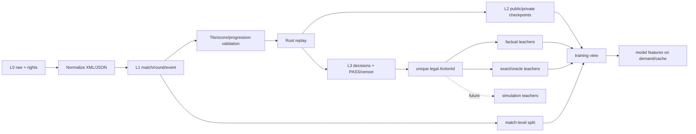

# RiYU Data Lake v1 詳細設計

作成日: 2026-11-26  
状態: 実装前設計案（コード・既存データ・学習artifactは未変更）  
基礎調査: [RiYU 牌譜データ基盤 調査・再設計報告](riyu_data_foundation_audit_2026-11-25.md)

本書では記述を次の4区分で扱う。監査報告またはraw/source codeで確認した値は**事実**、v1が従うべき規約は**設計決定**、容量・時間帯は**推定**、一次資料やpilotが必要な事項は**未解決**である。推定をsource factとして保存せず、未解決値をdefaultで補完しない。

## 0. 結論

新基盤の正本を `riyu-data-lake/v1` とし、次の7層に分ける。

```text
L0 raw            原本。変更しない
L1 canonical      対局・局・物理牌・完全イベント
L2 replay         公開/自席私有/oracle checkpoint
L3 opportunity    観測参照・意思決定機会・全合法手
L4 teacher        factual / exact / oracle / simulated教師
L5 split          半荘単位の固定splitと品質情報
L6 feature cache  モデル固有。破棄・再生成可能
```

推奨する中心設計は以下である。

1. 元SQLite/bzip2 XMLをL0のまま保存し、全派生物からSHA-256で参照する。
2. 元XMLの`0..135`物理牌IDを失わず、34種ID・赤・copy indexは検証可能な派生値として併存させる。
3. 対局共通の公開状態、各席本人だけが見える私有状態、全手牌・山を含むoracle状態を別table・別directoryにする。
4. 任意局面は「局開始header + canonical event + 32 event間隔checkpoint」から復元する。全判断snapshotは正本にしない。
5. PASSはactionである。応答がpriorityで打ち切られた状態はPASSではなく`censored`であり、方策教師maskをfalseにする。
6. 全合法手は、物理copy差を除いたsemantic `ActionId`と、実行用physical payloadを分離する。
7. 実結果、厳密計算、oracle、simulationを別tableと`label_origin`で二重に区別する。
8. 基盤はArrow/Parquet + ZSTDを正本にし、JSONL.zstは監査用exportに限定する。
9. モデル特徴量は原則学習時生成とし、必要になった場合だけL6へversion付きcacheを作る。
10. Rustがparse/replay/legal/exact label/Arrow出力を担当し、Pythonはmanifest、分析、split、feature、学習を担当する。

本書の`必須`はv1実装に必要、`任意`はschemaを予約するが初回全量加工では省略可能、`将来`は契約だけを定義する。

---

## 1. 設計原則と非目標

### 1.1 原則

- 正本はモデル非依存である。
- source factを上書きせず、解釈結果と併存させる。
- 不明、非該当、censored、計算未実施を同じnullへ潰さない。
- 1つの意味を同じschema version内で変更しない。
- 全派生rowはsource、converter、rule engine、schema、rightsへ遡れる。
- 半荘をshard、split、並列処理の最小整合性単位とする。
- 通常学習入力はobserver可視情報だけから生成できなければならない。
- 未選択actionの将来結果を実牌譜の事実として保存しない。

### 1.2 非目標

- v1で三麻rule engineを完成させない。三麻raw/canonicalは保持し、replay以降はquarantine可能にする。
- v1で山生成seedからの完全山復元を既成事実にしない。検証完了まで`unverified`とする。
- 特定CNN/Transformerのplaneやtokenをcanonical schemaへ入れない。
- 全候補のrollout trajectoryを永続保存しない。既定は集約分布だけを保存する。
- 既存decision/v1、sequence-v2/v4の列名を新しい意味で再利用しない。

---

## 2. 全体構成

### 2.1 table一覧

| domain | table | 設計対象 | v1 |
|---|---|---|---|
| catalog | `dataset_manifests` | dataset全体 | 必須 |
| catalog | `rights_records` | 許諾 | 必須 |
| catalog | `source_containers` | SQLite等のraw容器 | 必須 |
| catalog | `source_records` | 容器内の牌譜payload | 必須 |
| catalog | `rule_profiles` | ルール | 必須 |
| catalog | `action_catalog` | ActionId辞書 | 必須 |
| core | `matches` | 1. 対局 | 必須 |
| restricted metadata | `match_players` | 対局者/段位/R | 必須 |
| core | `rounds` | 2. 局 | 必須 |
| core | `round_wins` | 和了内訳 | 必須 |
| core | `events` | 3. イベント | 必須 |
| replay observable | `public_checkpoints` | 4. 公開checkpoint | 必須 |
| replay observable-private | `private_checkpoints` | 4. 本人用checkpoint | 必須 |
| replay restricted | `oracle_checkpoints` | 4. 完全情報checkpoint | 任意 |
| observable | `observations` | 5. 観測局面参照 | 必須 |
| observable | `decisions` | 6. 意思決定機会 | 必須 |
| observable | `decision_actions` | 7. 全合法手 | 必須 |
| teachers factual | `policy_labels` | 8. 方策 | 必須 |
| teachers exact/oracle | `attack_state_labels` | 9. 攻撃state | 必須 |
| teachers exact/oracle | `attack_action_labels` | 9. 攻撃action | 必須 |
| teachers oracle/exact | `defense_action_labels` | 10. 守備 | 必須 |
| teachers oracle | `opponent_state_labels` | 11. 他家状態 | 必須 |
| teachers factual | `opponent_action_labels` | 11. 他家次行動 | 必須 |
| teachers factual | `factual_action_outcomes` | 9/10/12. 実結果 | 必須 |
| teachers value | `reward_specs` | 12. reward定義 | 必須 |
| teachers value | `match_rewards` | 12. 半荘reward | 必須 |
| teachers simulated | `simulation_runs` | 13. 反実仮想実行 | 将来 |
| teachers simulated | `simulation_action_summaries` | 13. 反実仮想集約 | 将来 |
| governance | `split_assignments` | train/val/test | 必須 |
| governance | `quality_issues` | reject/警告 | 必須 |

### 2.2 table運用要約

以下は各tableのPK、主取得元、欠損方針、主要関連、全量時の容量帯、生成負荷を横断的にまとめたもの。容量は13章のplanning rangeに整合する概算で、pilot後にmanifestの実測値へ置き換える。

| table | PK | 主取得元 | 欠損時 | 主要関連 | 全量容量 | 生成負荷 |
|---|---|---|---|---|---:|---|
| `dataset_manifests` | `dataset_id` | build/reducer | complete化禁止 | 全file | <10MB | 低 |
| `rights_records` | `rights_scope_id` | 許諾記録 | fail closed | source/match | <10MB | 低・人手確認 |
| `source_containers` | `container_id` | raw container hash | containerをquarantine | rights/record | <10MB | hash I/O中 |
| `source_records` | `source_record_id` | locator + payload hash | recordをquarantine | container/match | 0.1〜0.3GB | 展開hash I/O中 |
| `rule_profiles` | `rule_profile_id` | GO/source仕様 | unknownをnull、parse-only | match/action | <10MB | 低・仕様確認 |
| `action_catalog` | `action_id` | canonical action | 衝突時停止 | decision action | <100MB | 低 |
| `matches` | `match_id` | raw meta/terminal | 個別列null、品質flag | player/round/split | 0.1〜0.3GB | 低 |
| `match_players` | `(match_id,seat)` | UN/BYE | null/quality code | match/split | 0.1〜0.3GB | 低 |
| `rounds` | `round_id` | INIT/terminal/replay | terminal不明はnull | match/win/event | 2〜8GB | 中 |
| `round_wins` | `(round_id,win_index)` | AGARI/scoring | 不明列null | round | 0.5〜3GB | 低〜中 |
| `events` | `(round_id,round_event_seq)` | XML tag + replay | 未対応tagをraw拡張へ | round/checkpoint | 8〜25GB | 中 |
| `public_checkpoints` | `checkpoint_id` | replay | 生成失敗はround reject | event/observation | 2〜8GB | 中 |
| `private_checkpoints` | `(checkpoint_id,observer)` | replay hidden state | seat非activeはrowなし | public CP/observation | 3〜10GB | 中 |
| `oracle_checkpoints` | `checkpoint_id` | full replay/verified wall | wall未検証はnull | public CP/oracle teacher | 0〜12GB | 中 |
| `observations` | `observation_id` | CP + event range | restore不能ならdecision reject | decision/CP | 3〜10GB | 低 |
| `decisions` | `decision_id` | rule engine/proof | censored/unknownを明示 | observation/action | 7〜20GB | 高 |
| `decision_actions` | `decision_id` | legal generator | incomplete status、label無効 | decision/catalog | 20〜60GB | 高 |
| `policy_labels` | `decision_id` | factual next event/proof | censored/unknown | decision/action | 3〜10GB | 中 |
| `attack_state_labels` | `decision_id` | exact hand analysis | not-run/unsupported | decision | 3〜10GB | 中〜高 |
| `attack_action_labels` | `decision_id` | exact candidate analysis | action単位status | decision/action | 7〜25GB | 高 |
| `defense_action_labels` | `decision_id` | hidden state + scoring | unsupported/null | decision/action | 20〜80GB | 非常に高 |
| `opponent_state_labels` | `decision_id` | oracle replay | hidden不明はnull | decision | 5〜100GB | 中〜高 |
| `opponent_action_labels` | `decision_id` | factual future scan | censored/no-future | decision/event | 5〜20GB | 中 |
| `factual_action_outcomes` | `decision_id` | factual reverse scan | 未到達はcensored | decision/round/match | 10〜30GB | 中 |
| `reward_specs` | `reward_spec_id` | 外部一次資料 | verified=false | match reward | <10MB | 低・人手確認 |
| `match_rewards` | `(match_id,reward_spec_id)` | terminal + reward spec | 入力不足はnull/status | match/spec | <0.5GB | 低 |
| `simulation_runs` | `simulation_run_id` | simulator config | partial/failed | decision | 対象依存 | 非常に高 |
| `simulation_action_summaries` | `(simulation_run_id,action_id)` | rollout集約 | N不足をdiagnostic | simulation/action | 10GB〜数百GB | 非常に高 |
| `split_assignments` | `(match_id,split_spec_id)` | deterministic planner | 未割当はrelease禁止 | match/全下位table | <0.5GB | 低〜中 |
| `quality_issues` | `issue_id` | 全stage validator | 該当scope null可 | match/round/decision | 0.1〜数GB | 中 |

teacherの「欠損」はrow不存在と列nullを使い分ける。計算profile対象外はrow不存在、対象だが値が得られない場合はrowを作り`label_status`とnull値を残す。

### 2.3 関係図



### 2.4 物理directory境界

```text
riyu-data-lake-v1/
  manifest.json
  catalog/                    # metadata。PIIなし
  core/                       # 完全イベント。学習jobへ直接mountしない
  restricted_metadata/        # player pseudonym、段位、R
  replay_observable/          # 公開checkpoint
  replay_private/             # observer本人用。seat一致joinのみ
  restricted_oracle/          # 全手牌、山、oracle教師
  observable/                 # observation locator、decision、legal action
  teachers_factual/           # 実結果
  teachers_exact/             # rule engineによる厳密結果
  teachers_simulated/         # simulation。別manifest
  governance/                 # split、quality、lineage
  feature_cache/              # 非正本、encoder version別
```

training processは`core/`と`restricted_oracle/`を入力featureとして読めないmount/ACLにする。教師として必要な列だけを、明示されたtraining viewへjoinする。

---

## 3. 共通型と識別子

### 3.1 Arrow/Parquet型

| 論理型 | Arrow型 | 規則 |
|---|---|---|
| stable ID | `fixed_size_binary[16]` | 128-bit。表示時hex |
| full digest | `fixed_size_binary[32]` | SHA-256 |
| action ID | `uint64` | canonical action SHA-256先頭64-bit。catalogで全digest衝突検査 |
| enum | `uint8`/`uint16` | code表をmanifestに固定。文字列へ意味変更しない |
| seat | `uint8` | absolute `0..3`。relative seatは別列 |
| tile type | `uint8` | `0..33` = m1..red dragon |
| physical tile | `uint8` nullable | canonical `0..135`。不明ならnull |
| score | `int32` | 点単位。100点単位に縮約しない |
| event sequence | `uint32` match / `uint16` round | 両方保持 |
| tile mask | `uint64` | 下位34 bitを使用 |
| 4-seat vector | `fixed_size_list<T>[4]` | 常にabsolute seat順 |
| 3-opponent vector | `fixed_size_list<T>[3]` | observer相対 `[下家,対面,上家]` |
| time | `timestamp[ms, UTC]` | source precisionを別列で保持 |
| arbitrary extension | `binary` nullable | source-specific CBOR。schema/version必須 |

固定配列をJSON文字列としてParquetへ入れない。NaN、空文字、`-1`を欠損sentinelに使わずArrow nullを使う。

### 3.2 stable ID

```text
container_id     = SHA256(raw container bytes)                      # 32 bytes
payload_sha256   = SHA256(payload bytes after transport decompression)
source_record_id = SHA256("riyu-source-record-v1" || container_id || canonical_locator)
match_digest     = SHA256("riyu-match-v1" || platform_code || payload_sha256)
match_id         = match_digest[0:16]
round_id         = SHA256("riyu-round-v1" || match_id || round_index)[0:16]
checkpoint_id    = SHA256("riyu-checkpoint-v1" || round_id || event_seq_after || kind)[0:16]
decision_id      = SHA256("riyu-decision-v1" || round_id || trigger_seq || seat || kind)[0:16]
observation_id   = decision_id
```

全128-bit IDはfull digest catalogで衝突検査し、1件でも衝突すれば変換を停止する。UUID、処理順依存の連番、Python `hash()`は使わない。

player pseudonymは公開形式のIDを単純SHA-256にせず、管理された秘密鍵による
`HMAC-SHA256(platform || raw_name_bytes)`の先頭128-bitを使う。鍵はdatasetに保存しない。

### 3.3 tile参照型

共通`TileRef`:

```text
struct<
  instance_id: uint8?,       # canonical physical 0..135
  source_id: uint16?,        # source native ID
  type_id: uint8,            # 0..33
  copy_index: uint8?,        # 0..3
  is_red: bool,
  identity_status: uint8     # 0 exact_source, 1 deterministic_assigned, 2 type_only
>
```

Tenhouでは`source_id=instance_id`、`type_id=instance_id/4`、`copy_index=instance_id%4`。赤はrule/source mappingで検証する。他sourceで物理copyが不明なら`instance_id`と`copy_index`をnullにし、推測で割り当てない。

### 3.4 欠損とlabel provenance

teacher tableは値だけでなく必ず次を持つ。

```text
label_status: uint8
  0 valid
  1 source_missing
  2 censored
  3 not_applicable
  4 rule_unsupported
  5 computation_not_run
  6 validation_failed

label_origin: uint8
  0 factual_direct
  1 factual_inferred_with_proof
  2 exact_replay
  3 exact_rule
  4 oracle_hidden
  5 external_reward_spec
  6 simulated
```

`label_status != valid`なら値列はnullにする。0やfalseを仮の負例にしない。

### 3.5 schema metadata

各Parquet file metadataに以下を必須化する。

```text
riyu.dataset_format = riyu-data-lake/v1
riyu.table_name
riyu.table_schema_version
riyu.converter_version
riyu.rule_engine_version
riyu.arrow_schema_sha256
riyu.source_manifest_sha256
riyu.rights_scope_id
riyu.created_at_utc
```

各fieldには`riyu.role = input | label | metadata | restricted | lineage`を付与する。意味変更時はtable schema versionを上げ、既存field IDを再利用しない。

---

## 4. catalog schema

### 4.1 `dataset_manifests`

| field | type | null | 意味/取得元 |
|---|---|---:|---|
| `dataset_id` | utf8 | no | immutable release ID |
| `format` | utf8 | no | `riyu-data-lake/v1` |
| `created_at` | timestamp UTC | no | build時刻 |
| `converter_version` | utf8 | no | git commit + CLI version |
| `rule_engine_version` | utf8 | no | Rust crate/version |
| `source_manifest_sha256` | binary[32] | no | source object set |
| `split_manifest_sha256` | binary[32] | yes | split未作成時null |
| `table_files` | list<struct> | no | path,row count,bytes,SHA-256,min/max key |
| `aggregate_rights_scope_id` | binary[16] | no | 最も厳しい利用条件 |
| `parent_dataset_ids` | list<utf8> | no | lineage |
| `status` | uint8 | no | building/complete/quarantined/retired |

PKは`dataset_id`。JSONのtop-level manifestを正本とし、このtableはcatalog query用mirrorでもよい。容量は数MB未満、計算負荷は低い。

### 4.2 `rights_records`

| field | type | null | 意味/取得元 |
|---|---|---:|---|
| `rights_scope_id` | binary[16] | no | PK |
| `platform` | uint8 | no | tenhou/mahjong_soul/local/... |
| `basis` | uint8 | no | user_owned/explicit_permission/open_license/generated |
| `authorization_reference` | utf8 | no | 許諾文書ID。本文を置かない |
| `allowed_uses_mask` | uint32 | no | parse/train/evaluate/internal_share/model_distribute等 |
| `raw_redistribution_allowed` | bool | no | raw再配布 |
| `derived_redistribution_allowed` | bool | no | 派生物再配布 |
| `model_distribution_allowed` | bool | no | model配布 |
| `contains_identifiers` | bool | no | raw PII |
| `effective_from/to` | timestamp UTC | yes | 期間制限 |
| `jurisdiction` | utf8 | yes | 記録がある場合のみ |
| `review_status` | uint8 | no | unreviewed/confirmed/revoked |

欠損した権利条件は「許可」とみなさずfail closed。容量は無視可能。派生datasetは親より緩いscopeを指定できない。

### 4.3 `source_containers`

| field | type | null | 意味/取得元 |
|---|---|---:|---|
| `container_id` | binary[32] | no | container bytes SHA-256、PK |
| `rights_scope_id` | binary[16] | no | FK |
| `storage_uri` | utf8 | no | DB path/object URI。環境別catalogで解決 |
| `container_format` | uint8 | no | sqlite/zip/tar/directory/... |
| `byte_length` | uint64 | no | raw length |
| `record_count` | uint32 | no | contained records |
| `acquired_at` | timestamp UTC | yes | 不明ならnull |
| `integrity_status` | uint8 | no | valid/corrupt/incomplete |
| `pii_class` | uint8 | no | none/pseudonymous/direct |

現在のSQLite全体を1 containerとして登録する。raw BLOBを別raw fileへ二重抽出せず、record locatorで参照する。容量は数MB未満、container hash計算は一度だけ。

### 4.4 `source_records`

| field | type | null | 意味/取得元 |
|---|---|---:|---|
| `source_record_id` | binary[32] | no | PK。container+locatorのdigest |
| `container_id` | binary[32] | no | FK |
| `match_id` | binary[16] | yes | parse成功後のFK。失敗時null |
| `canonical_locator` | utf8 | no | SQLite table/key等。restricted role |
| `record_ordinal` | uint32 | yes | container内順序 |
| `platform` | uint8 | no | namespace |
| `payload_format` | uint8 | no | tenhou_xml/majsoul_json/... |
| `transport_compression` | uint8 | no | bzip2/gzip/zstd/none |
| `stored_byte_length` | uint64 | no | container内bytes |
| `payload_byte_length` | uint64 | yes | 展開後。破損時null |
| `payload_sha256` | binary[32] | yes | transport展開後、semantic parse前のbytes |
| `integrity_status` | uint8 | no | valid/corrupt/incomplete |
| `parse_status` | uint8 | no | pending/valid/unsupported/rejected |

同じpayloadが複数containerにあれば`source_records`は複数row、`matches`は同じ`match_id`の1 rowになる。これによりDBのVACUUM、record順変更、再圧縮でmatch IDが変わらない。payload byte差は別matchとし、semantic duplicateは`duplicate_cluster_id`で別途束ねる。約33万rowで0.1〜0.3GB、全recordの展開hashがI/O負荷になる。

### 4.5 `rule_profiles`

既存`RuleConfig`を含み、source raw bitも保持する。

| field | type | null | 意味 |
|---|---|---:|---|
| `rule_profile_id` | uint16 | no | PK |
| `profile_version` | uint16 | no | 解釈version |
| `platform` | uint8 | no | source |
| `raw_rule_code` | uint32 | yes | Tenhou `GO.type`等 |
| `player_count` | uint8 | no | 3/4 |
| `match_length` | uint8 | no | east/east_south/... |
| `starting_score`,`target_score` | int32 | yes | 不明ならnull |
| `red_fives` | fixed_list<uint8>[3] | yes | m/p/s |
| `open_tanyao` | bool | yes | 未解釈ならnull |
| `multiple_ron_rule` | uint8 | yes | head_bump/double/triple_draw等 |
| `kazoe_limit` | uint8 | yes | sanbaiman/yakuman/... |
| `kiriage_mangan` | bool | yes | rule |
| `double_yakuman` | bool | yes | rule |
| `agari_yame`,`tenpai_yame` | bool | yes | rule |
| `west_extension`,`bankruptcy_end` | bool | yes | rule |
| `kokushi_ankan_chankan` | bool | yes | rule |
| `source_unknown_bits` | uint32 | no | 未解釈bitを保持 |
| `support_status` | uint8 | no | replay_supported/parse_only/quarantine |

ルール不明をRust defaultで埋めない。engine defaultはsimulation生成時の明示profileにだけ使う。

### 4.6 `action_catalog`

| field | type | null | 意味 |
|---|---|---:|---|
| `action_id` | uint64 | no | PK |
| `action_digest` | binary[32] | no | 衝突検査 |
| `action_schema_version` | uint16 | no | v1 |
| `action_type` | uint8 | no | discard/riichi/chi/pon/kan/ron/tsumo/abort/pass |
| `primary_tile_type` | uint8 | yes | tileなしactionはnull |
| `primary_is_red` | bool | yes | 同上 |
| `tile_origin` | uint8 | yes | hand/drawn/called/added |
| `from_relative` | uint8 | yes | 1..3 |
| `consume_types` | list<uint8> | no | sorted multiset |
| `consume_red_mask` | uint8 | no | consume各位置 |
| `kan_kind` | uint8 | yes | daiminkan/ankan/shouminkan |
| `abort_reason` | uint8 | yes | 九種九牌等 |
| `canonical_bytes` | binary | no | hash前の固定encoding |

数千〜数万row想定で容量は小さい。生成時に同じaction IDへ異なるcanonical bytesが来たら即停止する。

---

## 5. core schema

### 5.1 `matches` — 対局情報

| field | type | null | 意味/取得元 |
|---|---|---:|---|
| `match_id` | binary[16] | no | PK |
| `match_digest` | binary[32] | no | 衝突検査 |
| `primary_source_record_id` | binary[32] | no | metadata採用元。FK |
| `platform` | uint8 | no | source |
| `source_schema_version` | utf8 | yes | `mjloggm ver`等 |
| `source_started_at_text` | utf8 | yes | log ID等から得た未解釈の時刻表現 |
| `source_timezone` | utf8 | yes | source契約で確認できたIANA timezone。未確認ならnull |
| `started_at` | timestamp UTC | yes | timezoneまで確定できた場合だけ正規化 |
| `time_precision` | uint8 | no | unknown/hour/second |
| `rule_profile_id` | uint16 | no | FK |
| `raw_lobby_code` | uint32 | yes | `GO.lobby` |
| `shuffle_algorithm_id` | uint16 | yes | mt19937ar-sha512等 |
| `shuffle_seed` | binary | yes | source bytes。全山検証前でも保持 |
| `shuffle_seed_status` | uint8 | no | present_verified/present_unverified/missing |
| `initial_dealer` | uint8 | yes | `TAIKYOKU.oya` |
| `final_scores` | fixed_list<int32>[4] | yes | `owari` |
| `final_ranks` | fixed_list<uint8>[4] | yes | rule-aware計算。未対応ならnull |
| `final_adjustments` | fixed_list<float32>[4] | yes | `owari`精算値 |
| `round_count` | uint16 | no | accepted raw rounds |
| `source_quality_flags` | uint64 | no | disconnect/unknown tag/etc |
| `rights_scope_id` | binary[16] | no | lineage |

関連: `source_records`, `match_players`, `rounds`, `split_assignments`, `match_rewards`。同一payloadに複数source recordがある場合、完全性・取得時刻・locatorの決定規則でprimaryを一意に選び、source metadata不一致をquality issueにする。`rights_scope_id`は全sourceのうち最も厳しいscope。1 row/match、約33万rowなので100〜300MB程度。parse負荷は低い。

### 5.2 `match_players` — 対局者情報（restricted metadata）

| field | type | null | 意味/取得元 |
|---|---|---:|---|
| `match_id` | binary[16] | no | PK part/FK |
| `seat` | uint8 | no | PK part |
| `seat_active` | bool | no | 三麻空席をfalse |
| `player_pseudonym_id` | binary[16] | yes | HMAC。空席/不明はnull |
| `dan_code` | uint8 | yes | `UN.dan` |
| `rating` | float32 | yes | `UN.rate` |
| `source_attribute_code` | uint8 | yes | `UN.sx`等。学習入力へ既定で入れない |
| `metadata_event_count` | uint8 | no | 再接続UN回数 |
| `disconnect_count` | uint16 | no | `BYE` |
| `identity_quality` | uint8 | no | exact/missing/reconnected |

PK=`(match_id,seat)`。約124万active seat、100〜300MB。player splitと品質分析専用で、通常policy入力には使わない。

### 5.3 `rounds` — 局情報

| field | type | null | 意味/取得元 |
|---|---|---:|---|
| `round_id` | binary[16] | no | PK |
| `match_id` | binary[16] | no | FK |
| `round_index` | uint16 | no | source順、match内unique |
| `round_wind` | uint8 | yes | east/south/west/north |
| `hand_number` | uint8 | yes | 1..4 |
| `honba`,`riichi_sticks` | uint16 | no | INIT |
| `dealer` | uint8 | no | INIT |
| `dice` | fixed_list<uint8>[2] | yes | INIT.seed |
| `initial_scores` | fixed_list<int32>[4] | no | INIT.ten |
| `initial_hand_0..3` | list<TileRef> | yes | INIT.hai。inactive seatはnull |
| `initial_dora_indicator` | TileRef | no | INIT.seed |
| `initial_live_wall_count` | uint16 | yes | rule/source |
| `event_count` | uint16 | no | canonical event count |
| `end_reason` | uint8 | yes | ron/tsumo/exhaustive/abortive/unknown |
| `draw_reason` | uint8 | yes | yao9/kaze4/... |
| `end_scores` | fixed_list<int32>[4] | yes | replay/sc |
| `score_deltas` | fixed_list<int32>[4] | yes | sc |
| `tenpai_mask` | uint8 | yes | 流局開示/engine |
| `revealed_tenpai_hands` | list<struct<seat,tiles>> | yes | RYUUKYOKU.haiN |
| `terminal_event_seq` | uint16 | yes | event FK |
| `replay_status` | uint8 | no | supported/parse_only/rejected |
| `validation_flags` | uint64 | no | point/tile/progression |

PK=`round_id`、unique=`(match_id,round_index)`。約320万row。initial handsを保持するため2〜6GBを想定。局開始headerをeventsへ複製しない。

### 5.4 `round_wins` — 和了内訳

| field | type | null | 意味/取得元 |
|---|---|---:|---|
| `round_id` | binary[16] | no | PK part |
| `win_index` | uint8 | no | PK part。複数ロン順 |
| `winner`,`from_seat` | uint8 | no | AGARI who/fromWho |
| `win_method` | uint8 | no | ron/tsumo/chankan/rinshan等 |
| `winning_tile` | TileRef | yes | machi |
| `concealed_tiles` | list<TileRef> | yes | AGARI.hai |
| `meld_source_values` | list<uint32> | no | AGARI.m raw |
| `fu`,`han`,`base_or_total_points` | int16/int16/int32 | yes | AGARI.ten解釈 |
| `limit_code` | uint8 | yes | mangan等 |
| `yaku` | list<struct<id:uint16,han:int8>> | no | AGARI.yaku |
| `yakuman` | list<uint16> | no | AGARI.yakuman |
| `dora_indicators` | list<TileRef> | no | AGARI.doraHai |
| `ura_indicators` | list<TileRef> | no | AGARI.doraHaiUra |
| `pao_seat` | uint8 | yes | paoWho |
| `winner_gain`,`loser_payment` | int32 | yes | sc/score engine |

PK=`(round_id,win_index)`。約270万以上、1〜4GB想定。点数解釈が未検証でもraw fieldsを失わず、解釈列をnullにする。

### 5.5 `events` — canonical event

局headerとterminal detailは参照し、時系列を1 row/eventで持つ。

| field | type | null | 意味/取得元 |
|---|---|---:|---|
| `round_id` | binary[16] | no | PK part |
| `round_event_seq` | uint16 | no | PK part。0始まり |
| `match_id` | binary[16] | no | partition/join |
| `match_event_seq` | uint32 | no | 対局全体で単調。監査報告のseq曖昧さを解消 |
| `source_event_ordinal` | uint32 | no | raw XML直列位置 |
| `event_type` | uint8 | no | round_start/draw/discard/call/riichi/dora/pass/window_close/result/... |
| `actor` | uint8 | yes | seat |
| `target` | uint8 | yes | discard/ron target等 |
| `tile` | TileRef | yes | 主牌 |
| `from_seat` | uint8 | yes | call source |
| `meld_kind` | uint8 | yes | chi/pon/kan kind |
| `meld_tiles` | list<TileRef> | no | 非meldは空list |
| `called_tile` | TileRef | yes | open call |
| `tsumogiri` | bool | yes | source/derived |
| `tsumogiri_known` | bool | no | visual source対応 |
| `riichi_step` | uint8 | yes | declared/accepted |
| `rinshan` | bool | yes | draw |
| `dora_indicator` | TileRef | yes | reveal |
| `score_deltas` | fixed_list<int32>[4] | yes | terminal |
| `winner_mask` | uint8 | yes | multi-ron |
| `response_window_id` | binary[16] | yes | discard/kan responseを束ねる |
| `source_tag_code` | uint16 | no | raw tag mapping |
| `source_extension` | binary | yes | 未型付け属性をversioned CBORで保持 |
| `event_quality_flags` | uint32 | no | inferred/ambiguous/etc |

PK=`(round_id,round_event_seq)`、unique=`(match_id,match_event_seq)`。全牌譜で約3億row規模。typed Parquetで8〜25GBを想定。parseはstreamingで、matchを跨いだmutable stateを持たない。

元XMLにはPASSがないため、`events`へsynthetic passを事実として混ぜない。応答窓の閉じ方は`window_close` eventと`decisions.opportunity_status`で表す。明示PASSを持つsourceだけ`pass` eventを保存する。

---

## 6. replay/checkpoint schema

### 6.1 保存方式の比較

| 方式 | 容量 | random restore | schema柔軟性 | 判定 |
|---|---:|---:|---:|---|
| 全decision snapshot | 非常に大 | 最速 | state変更で全再生成 | 不採用（cacheのみ） |
| event only | 最小 | 局頭からreplay | 高い | 監査正本として保持 |
| event + periodic checkpoint | 中 | 最大K event replay | 高い | **採用** |

### 6.2 checkpoint間隔

既定`K=32 applied events`。次を必須checkpointにする。

- 局開始直後（event 0適用後）
- 以後32 eventごと
- terminal直後

復元は最大31 event適用。golden/debug datasetだけ、槓・リーチ受理前後へ追加checkpointを許す。1,000対局benchmarkでrandom restore p95が10msを超えた場合はK=16、checkpoint容量が予算を超える場合はK=64を比較する。Kはdataset manifestに固定する。

### 6.3 `public_checkpoints`

全席共通の公開情報を1回だけ保存する。

| field | type | null | 意味 |
|---|---|---:|---|
| `checkpoint_id` | binary[16] | no | PK |
| `round_id` | binary[16] | no | FK |
| `event_seq_after` | uint16 | no | このeventまで適用済み |
| `checkpoint_reason` | uint8 | no | start/periodic/terminal/debug |
| `state_schema_version` | uint16 | no | state contract |
| `scores` | fixed_list<int32>[4] | no | 公開 |
| `remaining_tiles`,`turn` | uint16 | no | 公開 |
| `current_actor` | uint8 | yes | phase |
| `phase` | uint8 | no | awaiting draw/discard/response/... |
| `phase_actor`,`phase_target` | uint8 | yes | phase payload |
| `phase_tile` | TileRef | yes | response tile |
| `dora_indicators` | list<TileRef> | no | 公開 |
| `riichi_states` | fixed_list<uint8>[4] | no | 公開 |
| `ippatsu_eligible` | fixed_list<bool>[4] | no | 公開 |
| `discards` | list<struct<seat,tile,tsumogiri,known,riichi,called_by>> | no | 全河 |
| `melds` | list<struct<seat,kind,tiles,called,from,event_seq>> | no | 全副露 |
| `pending_kan_public` | struct | yes | chankan window |
| `public_state_hash` | binary[32] | no | canonical state hash |

PK=`checkpoint_id`、unique=`(round_id,event_seq_after)`。3〜5 checkpoint/roundを仮定し、2〜8GB。batch replayで生成するため追加負荷は低〜中。

### 6.4 `private_checkpoints`

同じcheckpointの各active seat本人だけに見える状態。

| field | type | null | 意味 |
|---|---|---:|---|
| `checkpoint_id` | binary[16] | no | PK part/FK |
| `seat` | uint8 | no | PK part |
| `concealed_tiles` | list<TileRef> | no | 本人手牌（drawn除く） |
| `drawn_tile` | TileRef | yes | 本人ツモ |
| `temporary_furiten` | bool | yes | 正確に復元可能な場合 |
| `riichi_furiten` | bool | yes | 同上 |
| `private_state_hash` | binary[32] | no | private canonical hash |
| `reconstruction_status` | uint8 | no | exact/partial/unknown_pass |

PK=`(checkpoint_id,seat)`。公開状態を複製しない。active seat分で3〜10GB想定。join時に`seat == decisions.actor`を必須assertする。

### 6.5 `oracle_checkpoints`（任意・restricted）

| field | type | null | 意味 |
|---|---|---:|---|
| `checkpoint_id` | binary[16] | no | PK/FK |
| `hands_by_seat` | fixed_list<list<TileRef>>[4] | yes | 全実手牌 |
| `drawn_by_seat` | fixed_list<TileRef?>[4] | yes | 全seat draw |
| `live_wall_order` | list<TileRef> | yes | seed検証後のみ |
| `dead_wall_order` | list<TileRef> | yes | 同上 |
| `live_wall_cursor` | uint16 | yes | 消費位置 |
| `rinshan_cursor` | uint8 | yes | 嶺上位置 |
| `wall_reconstruction_status` | uint8 | no | unavailable/unverified/verified |
| `oracle_state_hash` | binary[32] | yes | complete時のみ |

v1初回全量では保存しなくてよい。全手牌はround+event replayで生成可能であり、teacher生成job内の一時stateに留める方が重複が少ない。山random accessが必要になった場合だけK=64等で追加する。

---

## 7. observable/opportunity/action schema

### 7.1 `observations` — 観測可能局面

state本体を複製せず、復元locatorとhashを持つ。

| field | type | null | 意味 |
|---|---|---:|---|
| `observation_id` | binary[16] | no | PK。decision_idと同値 |
| `round_id` | binary[16] | no | FK |
| `observer` | uint8 | no | viewpoint |
| `public_checkpoint_id` | binary[16] | no | FK |
| `private_checkpoint_id` | binary[16] | no | 同じID、seatはobserverでjoin |
| `replay_from_seq_exclusive` | uint16 | no | checkpoint event |
| `replay_to_seq_inclusive` | uint16 | no | decision直前まで |
| `visibility_contract_version` | uint16 | no | observer projection規則 |
| `public_state_hash` | binary[32] | no | 復元検証 |
| `private_state_hash` | binary[32] | no | 復元検証 |
| `observation_hash` | binary[32] | no | public+own private。cache key |
| `materialization_status` | uint8 | no | exact/partial/rejected |

PK=`observation_id`。1 row/decisionだが小さいlocatorだけなので10〜25GBを想定。計算負荷は最大31 events replay。

### 7.2 `decisions` — 意思決定機会

| field | type | null | 意味 |
|---|---|---:|---|
| `decision_id` | binary[16] | no | PK |
| `observation_id` | binary[16] | no | FK、同値 |
| `match_id`,`round_id` | binary[16] | no | joins |
| `actor` | uint8 | no | decision owner |
| `decision_kind` | uint8 | no | turn/response/kan_response/abortive |
| `trigger_event_seq` | uint16 | no | decisionを開いたevent |
| `decision_seq_in_round` | uint16 | no | actorを問わない順序 |
| `response_window_id` | binary[16] | yes | 同時応答group |
| `response_priority_class` | uint8 | yes | ron/pon-kan/chi |
| `opportunity_status` | uint8 | no | 下記 |
| `censor_reason` | uint8 | yes | higher_priority/same_priority/terminal/source_missing |
| `legal_set_status` | uint8 | no | complete/rule_unsupported/invalid_state |
| `source_selected_event_seq` | uint16 | yes | 選択が記録されたevent |
| `quality_flags` | uint32 | no | source/replay quality |

`opportunity_status`:

```text
0 turn_confirmed
1 response_selected
2 response_pass_explicit
3 response_pass_inferred_definite
4 response_censored
5 response_unknown
```

4/5はdecision rowとlegal setを保持してもよいが、policy labelはinvalid。次が通常drawなら3。call/ronで閉じた窓はpriority proofを作れた場合だけ限定的に3、それ以外は4。

### 7.3 ActionId正規化

Semantic ActionIdはobserver相対で、同種非赤physical copyを区別しない。

```text
discard  = (v1, discard, tile_type, red, origin=hand|drawn)
riichi   = (v1, riichi, tile_type, red, origin=hand|drawn)
chi/pon  = (v1, type, called_type/red, from_relative, sorted consume(type/red))
daiminkan= (v1, kan, daiminkan, called_type/red, from_relative, sorted consume)
ankan    = (v1, kan, ankan, tile_type, red_count)
shouminkan=(v1, kan, shouminkan, added_type/red, prior_meld_semantic_signature)
ron      = (v1, ron, target_relative)
tsumo    = (v1, tsumo)
abort    = (v1, abortive_draw, reason)
pass     = (v1, pass)
```

`tsumogiri` boolではなく`origin`をcanonicalにする。自摸牌と同種の手牌を切る場合、`hand`と`drawn`は公開履歴が変わるため別actionである。shouminkanの具体的meld event refはexecution payloadに置き、global ActionIdへmatch固有IDを入れない。

decision内の`action_index`は`canonical_bytes`のunsigned lexicographic順とする。v1のenum codeとfield encodingをschema artifactに固定し、例ではdiscardの`tile_type`昇順、同種なら`origin=hand`を`drawn`より先にする。処理系固有のenum順やhash map反復順は使わない。

### 7.4 `decision_actions` — 全合法手

Parquetでは1 action 1 rowにせず、1 decision 1 rowのnested listを採用する。

| field | type | null | 意味 |
|---|---|---:|---|
| `decision_id` | binary[16] | no | PK/FK |
| `action_schema_version` | uint16 | no | v1 |
| `action_set_hash` | binary[32] | no | ordered action IDs + execution payload |
| `actions` | list<ActionOccurrence> | no | canonical sort順 |
| `action_count` | uint8 | no | list length、冗長検証列 |

`ActionOccurrence`:

```text
struct<
  action_index: uint8,
  action_id: uint64,
  execution_tile_instance_ids: list<uint8>,
  called_tile_instance_id: uint8?,
  source_meld_event_seq: uint16?,
  target_absolute_seat: uint8?,
  engine_sort_key: binary,
  occurrence_flags: uint16
>
```

同じ`action_id`は1 decision内に一度だけ。物理的に等価な候補が複数あれば、execution payloadは最小lexicographic physical IDsを選ぶ。全合法手child viewが必要な分析時だけexplodeする。1.5〜2億decisionで20〜60GB想定、legal generationが主要計算負荷。

---

## 8. teacher schema

### 8.1 `policy_labels` — 方策教師

| field | type | null | 意味 |
|---|---|---:|---|
| `decision_id` | binary[16] | no | PK/FK |
| `label_status`,`label_origin` | uint8 | no | 共通規則 |
| `chosen_action_id` | uint64 | yes | valid時必須 |
| `chosen_action_index` | uint8 | yes | action axis |
| `choice_kind` | uint8 | yes | discard/pass/call/riichi/win/... |
| `evidence_event_seq` | uint16 | yes | source選択event |
| `pass_proof_code` | uint8 | yes | explicit/next_draw/priority_proof |
| `source_confidence` | float32 | yes | vision等。XML exactは1.0 |

PASSは`chosen_action_id=PASS`かつstatus validの場合だけ。censoredはchosen null。容量5〜15GB、計算負荷は低〜中。

### 8.2 `attack_state_labels`

observer本人のdecision直前state。

| field | type | null | 意味 |
|---|---|---:|---|
| `decision_id` | binary[16] | no | PK |
| `label_status`,`label_origin` | uint8 | no | exact_rule |
| `shanten_min` | int8 | yes | -1..6 |
| `shanten_normal`,`chiitoi`,`kokushi` | int8 | yes | breakdown |
| `wait_type_mask` | uint64 | yes | 34 bit |
| `theoretical_wait_count` | uint8 | yes | 4-visibleでなく種類数 |
| `current_win_legal` | bool | yes | ron/tsumo phase |
| `current_win_points` | int32 | yes | legal win時 |
| `current_yaku_mask` | binary | yes | versioned yaku bitset |

「将来成立可能な役」は定義が曖昧なのでv1 canonical labelにしない。`YakuPotentialSpec`（horizon、鳴き許可、山情報）を定義した派生teacherだけで生成する。

### 8.3 `attack_action_labels`

1 decision 1 row、action axisに沿う。

| field | type | null | 意味 |
|---|---|---:|---|
| `decision_id` | binary[16] | no | PK |
| `action_set_hash` | binary[32] | no | axis照合 |
| `labels` | list<AttackActionLabel> | no | applicable actions |

```text
AttackActionLabel = struct<
  action_index:uint8,
  action_id:uint64,
  label_status:uint8,
  shanten_after:int8?,
  ukeire_type_mask:uint64?,
  ukeire_type_count:uint8?,
  ukeire_theoretical_copies:uint8?,
  ukeire_visible_adjusted_copies:uint8?,
  ukeire_live_wall_copies:uint8?,       # oracle、wall verified時だけ
  tenpai_after:bool?,
  legal_win_points:int32?
>
```

shanten/理論受入はexact、live wall copiesはoracle。originが異なる値を同じ列に混ぜず、`ukeire_live_wall_copies`はrestricted teacher directoryへ分割してもよい。容量10〜40GB、候補ごとのshanten計算が中〜高負荷。

### 8.4 `defense_action_labels`

各合法打牌/リーチ/槓に対する即時反応を、同じ実hidden state上で厳密計算する。

| field | type | null | 意味 |
|---|---|---:|---|
| `decision_id` | binary[16] | no | PK |
| `action_set_hash` | binary[32] | no | axis照合 |
| `labels` | list<DefenseActionLabel> | no | applicable actions |

```text
DefenseActionLabel = struct<
  action_index:uint8,
  action_id:uint64,
  response_kind:uint8,                  # discard/chankan
  opponents:fixed_list<struct>[3] {
    opponent_relative:uint8,
    label_status:uint8,
    ron_legal:bool?,
    furiten_mask:uint8?,                 # discard/temporary/riichi
    winner_points:int32?,
    self_loss_points:int32?,
    han:int8?,
    fu:int16?,
    limit_code:uint8?
  },
  any_ron_legal:bool?,
  legal_winner_mask:uint8?,
  combined_self_loss:int32?,             # source multiple-ron rule適用
  combined_status:uint8
>
```

これは「即時ロン合法性」であり、「将来放銃確率」ではない。全候補×3相手のscore計算が高負荷。rule unsupportedならそのcellだけnull/statusを立てる。容量20〜80GB。

### 8.5 `opponent_state_labels`

| field | type | null | 意味 |
|---|---|---:|---|
| `decision_id` | binary[16] | no | PK |
| `opponents` | fixed_list<OpponentStateLabel>[3] | no | relative order |

```text
OpponentStateLabel = struct<
  opponent_relative:uint8,
  absolute_seat:uint8,
  label_status:uint8,
  hand_checkpoint_id:binary[16]?,
  concealed_tile_count:uint8?,
  hand_type_counts:fixed_list<uint8>[34]?,
  shanten_min:int8?,
  tenpai:bool?,
  wait_type_mask:uint64?,
  discard_furiten:bool?,
  temporary_furiten:bool?,
  riichi_furiten:bool?
>
```

full `hand_type_counts[34]`は容量が大きいのでprofileで選ぶ。

- `belief-lite`: shanten/tenpai/wait/furitenだけを永続化（推奨初回）。
- `belief-full`: 34 countも保存（他家手牌生成model用）。

実physical handはround+eventまたはoracle checkpointから得るため、毎decisionへlistを複製しない。lite 10〜30GB、full追加30〜100GB。

### 8.6 `opponent_action_labels`

実軌跡上の次行動だけを保存する。

| field | type | null | 意味 |
|---|---|---:|---|
| `decision_id` | binary[16] | no | PK |
| `opponents` | fixed_list<struct>[3] | no | relative seats |
| nested `next_action_status` | uint8 | no | valid/censored/no_future |
| nested `next_action_type` | uint8 | yes | discard/pass/call/riichi/win |
| nested `next_discard_type` | uint8 | yes | factual |
| nested `next_discard_red` | bool | yes | factual |
| nested `next_call_type` | uint8 | yes | chi/pon/kan |
| nested `events_until_action` | uint16 | yes | horizon |
| nested `evidence_event_seq` | uint16 | yes | source |

未選択自家action後の他家行動はここへ入れない。simulation tableへ入れる。容量5〜20GB、scan負荷は低い。

### 8.7 `factual_action_outcomes`

chosen actionにだけ、実軌跡の将来を関連付ける。

| field | type | null | 意味 |
|---|---|---:|---|
| `decision_id` | binary[16] | no | PK |
| `action_id`,`action_index` | uint64/uint8 | no | chosenのみ |
| `label_status`,`label_origin` | uint8 | no | factual |
| `round_terminal_event_seq` | uint16 | yes | terminal |
| `events_to_terminal` | uint16 | yes | horizon |
| `draws_to_tenpai` | uint16 | yes | 到達しなければcensored flag |
| `draws_to_win` | uint16 | yes | 同上 |
| `tenpai_reached`,`self_won` | bool | yes | factual |
| `self_deal_in` | bool | yes | factual |
| `deal_in_to_mask` | uint8 | yes | winner seats |
| `opponent_tsumo`,`horizontal` | bool | yes | factual |
| `round_outcome` | uint8 | yes | self_win/deal_in/op_tsumo/horizontal/draw |
| `round_id`,`match_id` | binary[16] | no | deltas/finalはjoinし重複しない |

局収支は`rounds.score_deltas`、半荘点/順位は`matches`からjoinし、各decisionへ複製しない。容量10〜30GB、future scanは1 round reverse passで低〜中負荷。

### 8.8 `reward_specs`

| field | type | null | 意味 |
|---|---|---:|---|
| `reward_spec_id` | binary[16] | no | PK |
| `service`,`room`,`match_length` | uint8 | no | 適用範囲 |
| `rank_band` | struct | yes | 段位条件 |
| `effective_from/to` | timestamp UTC | yes | 歴史version |
| `tie_break_rule` | uint8 | no | 同点 |
| `formula_kind` | uint8 | no | table/expression/plugin |
| `rank_rewards` | fixed_list<float32>[4] | yes | 単純table |
| `formula_payload` | binary | yes | versioned expression |
| `source_reference` | utf8 | no | 一次資料/設定 |
| `verified` | bool | no | production可否 |

仮の段位ptをproduction defaultにしない。`verified=false`は研究比較だけ。

### 8.9 `match_rewards`

| field | type | null | 意味 |
|---|---|---:|---|
| `match_id` | binary[16] | no | PK part |
| `reward_spec_id` | binary[16] | no | PK part |
| `rewards` | fixed_list<float32>[4] | yes | 4席 |
| `label_status`,`label_origin` | uint8 | no | external spec |
| `missing_inputs_mask` | uint32 | no | pt残高/試合数等 |
| `computation_version` | utf8 | no | reproducibility |

Rating変動の試合数補正などrawにない入力が必要ならstatusをsource_missingにし、近似しない。容量小、計算負荷低。

### 8.10 `simulation_runs` / `simulation_action_summaries`

`simulation_runs`:

| field | type | null | 意味 |
|---|---|---:|---|
| `simulation_run_id` | binary[16] | no | PK |
| `decision_id` | binary[16] | no | root |
| `simulator_version`,`rule_engine_version` | utf8 | no | provenance |
| `belief_source_id` | binary[16] | yes | hidden world generator |
| `self_policy_id`,`opponent_policy_id` | utf8 | no | rollout policy |
| `reward_spec_id` | binary[16] | yes | utility |
| `root_seed` | uint64 | no | reproducibility |
| `budget` | struct | no | samples/time/depth |
| `termination_rule` | uint8 | no | round/match/leaf |
| `created_at` | timestamp UTC | no | run |
| `status` | uint8 | no | complete/partial/failed |

`simulation_action_summaries`:

| field | type | null | 意味 |
|---|---|---:|---|
| `simulation_run_id` | binary[16] | no | PK part |
| `action_id` | uint64 | no | PK part |
| `action_index` | uint8 | no | root axis |
| `sample_count` | uint32 | no | N |
| `utility_mean`,`utility_std`,`standard_error` | float32 | yes | 集約 |
| `utility_quantiles` | fixed_list<float32>[5] | yes | p05/25/50/75/95 |
| `round_outcome_counts` | fixed_list<uint32>[6] | yes | win/deal/etc |
| `round_delta_mean` | float32 | yes | points |
| `deal_in_probability` | float32 | yes | simulated |
| `final_rank_counts` | fixed_list<uint32>[4] | yes | match horizon |
| `diagnostics` | struct | yes | ESS、truncation、errors |

実結果/exact tableへmergeしない。raw trajectoryはdebug samplingだけ別の期限付きdatasetに置く。容量は対象decision数とNに依存するが、summaryだけなら1 action数十〜数百bytes、全decision対象でも数十〜数百GB。全trajectoryはTB級になり得る。

---

## 9. governance schema

### 9.1 `split_assignments`

| field | type | null | 意味 |
|---|---|---:|---|
| `match_id` | binary[16] | no | PK |
| `split_spec_id` | binary[16] | no | split version |
| `partition` | uint8 | no | train/validation/final_test/quarantine |
| `assignment_key_hash` | binary[32] | no | deterministic proof |
| `time_bucket` | uint16 | yes | YYYYMM等 |
| `player_component_id` | binary[16] | yes | player-aware split |
| `duplicate_cluster_id` | binary[16] | yes | semantic duplicate cluster |
| `reason_code` | uint8 | no | hash/time/player/quarantine |

PK=`(match_id,split_spec_id)`。半荘より下位のtableはmatch assignmentを継承し、自前でhash splitしない。

推奨する3つの評価面:

1. `iid_match_v1`: match hash 80/10/10。
2. `temporal_v1`: 例として末期期間をfinal test。期間はデータ分布確認後に確定。
3. `player_disjoint_v1`: player graph componentを分離した研究用評価。

主学習splitを1つに固定し、時期/player splitはrobustness評価として併設する。

### 9.2 `quality_issues`

| field | type | null | 意味 |
|---|---|---:|---|
| `issue_id` | binary[16] | no | PK |
| `match_id`,`round_id`,`decision_id` | binary[16] | yes | 最小scope |
| `stage` | uint8 | no | raw/normalize/replay/action/teacher |
| `severity` | uint8 | no | info/warn/reject/fatal |
| `issue_code` | uint16 | no | versioned taxonomy |
| `message_template_id` | uint16 | no | 集約可能 |
| `details` | binary | yes | versioned CBOR。PII禁止 |
| `converter_version` | utf8 | no | lineage |

例外を文字列だけでreportせず、安定issue codeで集計する。reject rowを黙って捨てない。

---

## 10. 一つの実牌譜を加工した例

監査報告で使用した実牌譜（raw log IDは非掲載）を簡略化する。

### 10.1 match/round

```json
{
  "matches": {
    "match_id": "m:7bae33...",
    "platform": "tenhou",
    "source_started_at_text": "2020010100",
    "source_timezone": null,
    "started_at": null,
    "time_precision": "hour",
    "rule_profile_id": 1,
    "raw_rule_code": 169,
    "shuffle_seed_status": "present_unverified",
    "final_scores": [8900, 42800, 26600, 21700],
    "round_count": 17
  },
  "rounds": {
    "round_id": "r:...:00",
    "round_index": 0,
    "round_wind": "east",
    "hand_number": 1,
    "dealer": 0,
    "initial_scores": [25000,25000,25000,25000],
    "initial_dora_indicator": {"instance_id":93,"type_id":23,"is_red":false},
    "end_reason": "ron",
    "score_deltas": [0,8700,-7700,0]
  }
}
```

このsource recordから直接得られる時刻文字列は`2020010100`（時精度）である。この設計例ではsource時刻帯を監査資料だけから確定していないため、UTCへ推測変換せず`source_timezone`と`started_at`をnullにする。`rule_profile_id=1`はdataset内辞書IDであり、sourceの`GO.type=169`とは別物である。

### 10.2 events

```json
[
  {"round_event_seq":0,"match_event_seq":0,"source_event_ordinal":4,"event_type":"round_start"},
  {"round_event_seq":1,"match_event_seq":1,"source_event_ordinal":5,"event_type":"draw","actor":0,
   "tile":{"instance_id":97,"source_id":97,"type_id":24,"copy_index":1,"is_red":false}},
  {"round_event_seq":2,"match_event_seq":2,"source_event_ordinal":6,"event_type":"discard","actor":0,
   "tile":{"instance_id":104,"source_id":104,"type_id":26,"copy_index":0,"is_red":false},"tsumogiri":false},
  {"round_event_seq":3,"match_event_seq":3,"source_event_ordinal":7,"event_type":"draw","actor":1,
   "tile":{"instance_id":53,"source_id":53,"type_id":13,"copy_index":1,"is_red":false}}
]
```

上記physical IDsはraw XMLの`T97,D104,U53`と照合した実値で、`type_id=floor(instance_id/4)`である。他observer向けにtileをnullにしたeventを4重保存しない。canonical eventは完全情報を1回保存し、projection時に他家drawを隠す。

### 10.3 observation/decision/actions

```json
{
  "decision": {
    "decision_id": "d:...",
    "actor": 0,
    "decision_kind": "turn",
    "trigger_event_seq": 1,
    "opportunity_status": "turn_confirmed",
    "legal_set_status": "complete"
  },
  "observation": {
    "public_checkpoint_id": "cp:start",
    "private_checkpoint_id": "cp:start",
    "replay_from_seq_exclusive": 0,
    "replay_to_seq_inclusive": 1,
    "observer": 0
  },
  "actions": [
    {"action_index":0,"action_id_display":"discard:m1:hand","execution_tile_instance_ids":[1]},
    {"action_index":1,"action_id_display":"discard:m2:hand","execution_tile_instance_ids":[6]},
    {"action_index":9,"action_id_display":"discard:s7:hand","execution_tile_instance_ids":[99]},
    {"action_index":10,"action_id_display":"discard:s7:drawn","execution_tile_instance_ids":[97]},
    {"action_index":11,"action_id_display":"discard:s9:hand","execution_tile_instance_ids":[104]},
    {"action_index":12,"action_id_display":"discard:green:hand","execution_tile_instance_ids":[130]}
  ],
  "policy_label": {
    "label_origin":"factual_direct",
    "chosen_action_index":11,
    "choice_kind":"discard"
  }
}
```

`actions`は13候補中6候補だけを示した抜粋である。実保存の`action_id`は`uint64`、ここでは可読性のためcatalogの表示文字列を`action_id_display`として示した。初期手牌の同種s7（ID 99）と自摸s7（ID 97）は、公開される手出し/自摸切りが異なるため別actionになる。実際の選択はraw `D104`に対応するindex 11である。

### 10.4 teacher

```json
{
  "attack_state": {
    "label_status":"computation_not_run",
    "label_origin":"exact_rule",
    "shanten_min":null
  },
  "attack_actions": [
    {"action_index":11,"label_status":"computation_not_run",
     "shanten_after":null,"ukeire_type_mask":null}
  ],
  "defense_actions": [
    {"action_index":11,
     "opponents":[
       {"opponent_relative":1,"label_status":"computation_not_run","ron_legal":null},
       {"opponent_relative":2,"label_status":"computation_not_run","ron_legal":null},
       {"opponent_relative":3,"label_status":"computation_not_run","ron_legal":null}
     ],
     "label_origin":"oracle_hidden"}
  ],
  "factual_outcome": {
    "action_index":11,
    "round_outcome":"horizontal",
    "round_id":"r:...:00",
    "label_origin":"factual_direct"
  }
}
```

この設計作業では新rule engineによるteacher計算を実行していないため、shantenと即時ロン合法性を推測値で埋めず`computation_not_run`とnullにした。`factual_outcome=horizontal`だけは、この局がseat 1の和了・放銃seat 2で終わった実軌跡から得た事実である。未選択actionには将来exact shanten/即時ロンを付けられるが、実局の`round_outcome`は付けない。simulation未実行ならsimulation row自体が存在しない。

---

## 11. 事前計算と遅延生成

| 情報 | canonical build | teacher build | 学習時 | 理由 |
|---|---:|---:|---:|---|
| raw hash/rights/rules | ✓ |  |  | lineage |
| physical events | ✓ |  |  | 正本 |
| periodic checkpoints | ✓ |  |  | 汎用random restore |
| observation locator | ✓ |  |  | model非依存 |
| decisions/legal actions | ✓ |  |  | 全学習共通 |
| policy labels/PASS proof | ✓ |  |  | factual contract |
| shanten/waits |  | ✓ |  | engine version依存だが汎用 |
| candidate ukeire |  | ✓ |  | 高負荷、profileで選択 |
| immediate ron/points |  | ✓ |  | 高負荷oracle exact |
| opponent lite labels |  | ✓ |  | belief共通 |
| full 34-count hand labels |  | 任意 | 任意 | 容量大 |
| round/match factual outcome | ✓ |  | join | 重複回避 |
| reward |  | spec別 | join | reward変更可能 |
| model planes/tokens |  |  | ✓/cache | model固有 |
| rollout counterfactual |  | 別job |  | simulator/policy依存 |
| full wall |  | seed検証後 |  | 未検証を確定値にしない |

feature生成がepoch時間の10%以上を占めることをprofilingで確認した場合だけ、`feature_cache/<encoder_id>/`へ保存する。cache keyは`observation_hash + action_set_hash + encoder_version`。teacherと同じfileへ入れず、入力列allowlistを維持する。

---

## 12. 保存形式・Parquet仕様

### 12.1 形式比較

| 形式 | 長所 | 短所 | 用途 |
|---|---|---|---|
| 原SQLite/bzip2 XML | sourceそのもの | 分散read/列選択に弱い | L0 immutable |
| JSON | debug容易 | 冗長、型弱い、random access弱い | 1件例、API |
| JSONL.zst | streaming、監査 | 列pruning不可、nested重い | export/差分調査 |
| Arrow IPC | 高速、dense tensor向き | 長期互換/partition管理が弱い | feature cache候補 |
| Parquet+ZSTD | 圧縮、列pruning、分散処理 | schema設計が必要 | L1〜L5正本 |

### 12.2 Parquet列・encoding

- Compression: ZSTD level 3を加工中既定、archive releaseはlevel 6との実測比較後に決定。
- Row group: uncompressed 64〜128MiB目標。matchをrow group間で分割しない。
- File: compressed 256〜512MiB目標。最低64MiB、1GiB超を避ける。
- Sort: `match_id, round_index, event_seq`または`decision_id`。
- enum/action ID/match IDはdictionary encoding。連番はdelta encoding。
- tile maskは`uint64`、小配列はfixed-size list、action axisはnested list。
- file footerにmin/max match ID、row count、logical row digestを記録する。
- Parquet byte列の完全一致はArrow versionで変わり得るため、macOS/Linux再現性はcanonical logical row hashで判定する。

### 12.3 partition/shard

```text
table=events/platform=tenhou/year=2020/month=01/part-00000.parquet
table=decisions/platform=tenhou/year=2020/month=01/part-00000.parquet
```

partition keyを増やしすぎない。段位、action type、splitでdirectory partitionしない。splitはtable join、action typeはcolumn filterを使う。shard boundaryはmatch ID範囲で固定し、同じmatchを複数fileへ跨がせない。

### 12.4 commit protocol

1. workerは一意の一時pathへ書く。
2. row count、schema hash、logical digest、SHA-256を検証する。
3. local FSはatomic rename、object storageはimmutable object upload。
4. reducerが全shardを検証してからmanifest statusを`complete`にする。
5. incomplete shardはmanifestへ入れない。

---

## 13. 容量と時間

### 13.1 実測基準

監査報告の事実:

- raw DB: 2.21GB、解凍XML: 4.70GB。
- 328,424対局、3,196,694局、約3.05億XML直列要素。
- 現Python decision変換は全量外挿で約2か月、sequence系は約3か月になり得る。

### 13.2 v1 planning range（推定）

| layer | 容量 |
|---|---:|
| L0 raw + catalog | 2.5〜6GB |
| matches/players/rules/rounds/wins | 4〜12GB |
| canonical events | 8〜25GB |
| public/private checkpoints K=32 | 5〜18GB |
| observations/decisions | 10〜30GB |
| nested legal actions | 20〜60GB |
| factual + attack lite + opponent lite | 20〜60GB |
| defense exact | 20〜80GB |
| opponent full hand-count追加 | 30〜100GB |
| simulation summary | 対象範囲次第で10GB〜数百GB |

推奨core profile（simulationなし、opponent lite）は合計70〜220GBを計画容量とする。Parquet pilot実測で更新する。

### 13.3 加工時間（仮説、benchmark前）

| job | M4 24GB planning | TSUBAME planning |
|---|---:|---:|
| canonical parse/events | 12〜48時間 | 32 workerで1〜6時間 |
| checkpoint/decision/legal | 2〜7日 | 32 workerで2〜16時間 |
| attack/opponent lite | 2〜10日 | 32 workerで4〜24時間 |
| 全action即時ロン/点数 | 1〜3週間 | 32〜128 workerで8〜72時間 |

これは目標帯であり実測ではない。1,000対局でcorrectness、10,000対局でthroughput/RSS/compressionを測り、95%信頼区間ではなく実観測のp50/p95とsource mix別速度から全量ETAを再計算する。

M4 workerは4〜6 processを初期値、1 workerあたりArrow batch 16k〜64k rows、全体peak RSS 12GB以下をgateとする。24GBを使い切らず、OS cacheと学習/検証余地を残す。

---

## 14. Rust / Python / TSUBAME

### 14.1 Rust

- SQLite/bzip2/XML streaming reader
- source schema decoderとraw field保持
- physical tile ledger
- rule profile解釈
- canonical event生成
- public/private/oracle replay state
- legal actionとActionId canonical bytes
- PASS/censor proof engine
- shanten、ukeire、wait、furiten、scoring
- checkpoint生成
- Arrow RecordBatch/Parquet writer
- row-level validationとlogical digest

performance-criticalなmatch内処理をRustで完結し、Pythonへ1 decisionずつJSON/PyO3往復しない。

### 14.2 Python

- build plan/manifest orchestration
- rights/split/quality catalog
- PyArrowでのtable joinと統計
- pilot sampling、bias分析、dataset card
- model-specific feature/cache
- DataLoader/training/evaluation
- simulation jobの実験設定と集約（simulator本体はRust）

### 14.3 macOS/Linux portability

- Rust stable toolchain、Arrow/Parquet major version、ZSTD versionをlockする。
- `usize`、native endian binary、Python pickleを永続形式に使わない。
- 全timestamp UTC、文字列UTF-8、IDはbyte列。
- platform差の合格条件はlogical row hash一致。Parquet file bytes一致を要求しない。
- macOSとLinuxで同じgolden matchを変換し、全tableのcanonical row digestを比較する。

### 14.4 TSUBAME batch

SLURM job arrayを想定する。

```text
planner: source manifest -> match ID range tasks
worker:  task rangeをlocal scratchへstage -> immutable shards出力
reducer: schema/hash/coverage/duplicate検証 -> complete manifest
teacher arrays: canonical shard manifestを入力に独立実行
```

- worker間でSQLiteへwriteしない。
- source DBを共有FSから毎row random readせず、task単位でlocal scratchへstageまたは順次scanする。
- IDは処理順に依存しない。
- retryは同じtask ID/seedから同じlogical rowsを生成する。
- 32 worker時のparallel efficiency 70%以上を目標とし、shared storage飽和を別metricにする。

---

## 15. pipeline



各stageは入力manifestと出力manifestを持ち、途中stageを上書きしない。schema/engine version変更は新dataset IDを作る。

---

## 16. テストと合格基準

### 16.1 source/canonical

| test | 合格基準 |
|---|---|
| raw hash/integrity | 全container hash一致、全valid recordのpayload hash一致、SQLite integrity `ok` |
| XML parse | 対象328,424対局100% parse。未知tag/attrはextensionまたは明示reject |
| source coverage | raw既知fieldがtyped field/extension/L0参照のいずれかへ100%追跡可能 |
| ID determinism | 同一input/versionでlogical ID 100%一致 |
| physical tiles | accepted roundで同一physical IDの不可能な重複0、type/red mapping error 0 |
| rule mapping | DB flag、GO.type、profileの矛盾0。未知bitを保存 |

### 16.2 replay

| test | 合格基準 |
|---|---|
| hand conservation | 各event後の手牌/副露枚数がrule invariantを満たす |
| scores | accepted roundのterminal delta/end score 100% source一致 |
| progression | 次局initial score/dealer/honba/供託100%整合、例外はissue code |
| checkpoint restore | round start replayとcheckpoint replayのcanonical state hash 100%一致 |
| all viewpoints | own draw visible、opponent draw hidden、公開情報一致。違反0 |
| cross-platform | macOS/Linux logical row hash 100%一致 |

unsupported三麻はrejectedではなく`parse_only/quarantine`としてcanonical保持し、四麻replay母数へ入れない。

### 16.3 decisions/actions/PASS

| test | 合格基準 |
|---|---|
| action uniqueness | 全complete decisionでActionId重複0 |
| chosen membership | valid policy labelでchosenがlegal setにexactly one |
| action stability | physical non-red copy置換でsemantic ActionId不変 |
| red distinction | 赤/非赤で公開結果が変わるfixtureは別ActionId |
| PASS proof | pass label全件にexplicit/next_draw/priority proof |
| censored safety | censored/unknownにPASS label 0件 |
| furiten | ron pass fixtureでtemporary/riichi furitenがsource ruleと一致 |

### 16.4 leakage

| test | 合格基準 |
|---|---|
| hidden perturbation | 合法なhidden hand/wall置換でobservable row/features bit-identical |
| future truncation | decision後eventを除いてもobservation hash一致 |
| seat join | private checkpoint seat != actorのjoinをloaderが必ずreject |
| schema role | input allowlistに`restricted`/`label` field 0 |
| mount test | production DataLoaderから`restricted_oracle/` pathが不可視 |

### 16.5 teacher

| test | 合格基準 |
|---|---|
| status/null | non-valid labelにnon-null値0 |
| origin separation | simulated rowがfactual/exact directoryに0 |
| shanten crosscheck | golden + random sampleで独立実装と一致。差分0を目標、差分は全件分類 |
| score crosscheck | source AGARI/scとengine結果がsupported rulesで一致 |
| action axis | teacher action_set_hashがdecision_actionsと100%一致 |
| unchosen outcome | factual outcomeはchosen actionだけ。違反0 |

### 16.6 split/duplicate/bias

| test | 合格基準 |
|---|---|
| match leakage | train/validation/finalのmatch intersection 0 |
| duplicate leakage | duplicate clusterのpartition跨ぎ0 |
| temporal policy | final periodがtrainへ入らない |
| player evaluation | player-disjoint specでpseudonym intersection 0、除外率を報告 |
| action distribution | action機会数、label数、率をtype/rule/dan/month別に出力 |
| player concentration | top1/10/100 exposureとweight shareをdataset cardへ記録 |

### 16.7 performance gate

- M4 peak RSS 12GB以下。
- random observation restore p95 10ms以下（K=32、単一process、warm cache条件も併記）。
- 10,000対局pilotにsilent drop 0。
- Parquet file 64MiB未満のsmall-file率5%未満（最終partial shard除外）。
- TSUBAME 32 worker parallel efficiency 70%以上を目標。未達ならI/O profileを先に直し、worker数を増やさない。

---

## 17. 実装順序

1. `rights_records`, `source_containers`, `source_records`, manifest、schema registryを凍結。
2. `TileRef`、ID、enum code、logical digestのcross-platform fixtureを作る。
3. lossless Tenhou normalizerを作り、`matches/players/rounds/wins/events`をgolden数十対局で生成。
4. rule profile mappingを全`GO.type`で検証し、三麻をparse-onlyに分ける。
5. physical tile ledger、score/progression validatorを実装。
6. public/private replay stateとK=16/32/64 benchmarkを行いKを確定。
7. observation locator、decision window、PASS/censor proofを実装。
8. ActionSchema/v1、action catalog、dedup、chosen membershipを完成。
9. factual teacher、round/match outcome join、match-level splitを作る。
10. attack/opponent-lite exact teacherを追加。
11. defense immediate ron/scoreを追加し、外部fixtureで点数crosscheck。
12. 1,000対局correctness pilot、10,000対局capacity/performance pilot。
13. dataset card、reject taxonomy、全量ETA、storage見積もりを更新。
14. core profileだけ全量加工する。opponent-full/defense-heavyは別releaseとして段階化。
15. model feature cacheとsimulation teacherはcore dataset承認後に実装。

大規模学習は、L0〜L5のacceptance gateとsealed final splitが確定するまで開始しない。

---

## 18. 既存監査報告への修正・精密化

監査報告の方向性は維持するが、詳細設計では次を修正する。

1. **event sequence:** 既存Rust commentはmatch全体sequence、現Tenhou converterはroundごとに0へ戻す。新schemaは`match_event_seq`と`round_event_seq`を両方持ち曖昧さをなくす。
2. **山復元:** `SHUFFLE seed`存在だけで「復元可能」と確定しない。algorithm実装、既知draw/doraとの全件crosscheck完了までは`present_unverified`。
3. **player匿名化:** 単純SHA-256は公開名への辞書攻撃が可能。秘密鍵HMACへ変更する。
4. **checkpoint:** 「完全state checkpoint」1種類ではなく、public/private/oracleを分離し、公開情報4重複を避ける。
5. **legal action storage:** 1 action 1 rowより1 decision 1 nested listを既定とし、decision key反復を削減する。
6. **ActionIdと実行payload:** semantic identityへmatch固有physical IDを入れず、engine実行に必要なphysical tilesをoccurrence側へ置く。
7. **最終結果:** 最終順位/点を各decisionへ複製せず、round/match factへjoinする。
8. **役可能性:** 「成立可能な役」はhorizon未定義では教師にならない。specを定めた派生labelに限定する。
9. **rights:** immutableは法的削除義務より優先しない。revocation/takedown時はsourceをquarantine/deleteし、lineageから派生shard/modelを特定する。

---

## 19. 未解決事項

実装前に決定または実測が必要である。

1. 天鳳`SHUFFLE seed`からの山生成実装と全件crosscheck可否。
2. `GO.type`全11値の一次資料に基づく完全rule mapping。
3. 複数ロン、責任払い、流し満貫、同点順位等のRust coverage。
4. response priorityから確定PASSを導く範囲。安全側は「次が通常draw」のみ。
5. checkpoint K=16/32/64の実容量とrandom restore latency。
6. nested Arrow structのRust/PyArrow双方でのwrite/read性能。
7. 1 decisionあたり合法手数分布とaction tableの実圧縮率。
8. defense exact計算の全量コスト。全decisionかsampling/profile化か。
9. opponent `hand_type_counts[34]`を初回releaseへ含めるか。
10. 半荘報酬`RewardSpec`の対象サービス・段位・時期別一次資料。
11. 許諾参照`user-confirmed-permitted-2026-10-19`の実文書と派生model配布範囲。
12. TSUBAMEのfilesystem帯域、job上限、利用可能Arrow/Rust toolchain。
13. player-disjoint splitのgraph partition除外率と分布歪み。
14. semantic duplicate signatureの定義（shuffle seed、event、score、player metadataの扱い）。

未解決事項を仮値で埋めたまま全量加工しない。各決定はversioned specまたはpilot reportとしてmanifestから参照可能にする。
