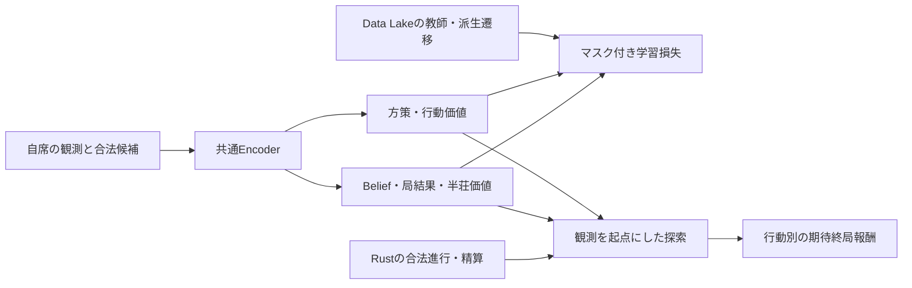

# RiYUの学習モデルおよび学習アルゴリズム設計

2026年11月28日。対象は四人打ちリーチ麻雀の半荘。最終目標は、対象卓の相手分布に対する**半荘当たりの期待段位戦ポイント**。初回は、同じ合法手・観測・計算予算で、模倣、実結果回帰、CQL、IQL、客観的な補助教師の効果を比較する。モデル規模と探索は、比較結果を受けて選ぶ。以下のモデル規模、予算、閾値は設計案であり、RiYUの学習実績は既存報告に明示した数値に限る。

## 1. 最初に決めること

- **観測と候補の契約を先に固定する。** 自席の手牌・ツモ、公開状態、観測できた履歴、合法行動の意味表現を使う。打牌、リーチ、PASS、ロン、鳴き、槓を同じ候補評価器で扱う。鳴き後の打牌は、成立した枝の次の意思決定とする。
- **基準モデルは小型の牌種別ResNet。** MLPを低コスト基準、イベント列を加える混合型を次の候補にする。補助ヘッドの精度、対戦での改善、バッチ推論時の費用を合わせて選定する。
- **終局順位と点数を報酬体系から分離して保存する。** 初回は順位分布と明示した仮報酬で方法を比較できる。サービス・卓・段位・適用時期の報酬が確定した後、同じ事実データから学習用報酬を再計算する。
- **探索と自己対戦の始点を公開情報に限定する。** 対戦相手の方策と隠れた牌の仮説を条件に、合法行動ごとの期待終局報酬を見積もる。対戦評価の基準は複数の固定対戦相手に対する半荘単位の比較とする。

## 2. 先行研究

表の内容は引用先の論文・コード・開発者説明で確認した公開時点の情報。同じ製品でも時期により構成が異なる。公開レポートの段位や精度は、卓、ルール、相手、評価法が一致する場合に比較できる。

| 研究・実装 | 入力、モデル、学習 | 報酬、他家推定、探索 | 計算資源・評価・RiYUへの適用 |
|---|---|---|---|
| 水上・鶴岡ほか | 牌譜の手牌・公開進行を特徴化し、相手の聴牌、待ち、和了点を教師ありで推定。2015年の別研究では半荘の最終順位推定を導入。2016年には別設定で効率的な和了のための強化学習も報告 | 予測した相手の分布を用いるモンテカルロ。初期の局評価と後続の期待最終順位方式は個別の研究 | CIG 2015では天鳳2,643戦でR1718を報告。統一したGPU予算は確認できない。分解した他家教師と縦断的な最終順位評価を移植候補とする。[CIG 2015論文](https://www.logos.t.u-tokyo.ac.jp/~tsuruoka/papers/cig2015mizukami.pdf)・[期待最終順位の研究](https://ipsj.ixsq.nii.ac.jp/records/145804)・[GPW 2016論文](https://ipsj.ixsq.nii.ac.jp/record/175342/files/IPSJ-GPWS2016013.pdf) |
| 爆打 | 水上開発の実運用システム。牌譜学習・相手モデル・モンテカルロ系。公開研究と稼働版の入力詳細、最終学習構成、計算費用の一対一対応は不明 | 相手の状態や局面をサンプルして行動を比較。稼働版の全報酬設定・自己対戦の有無は確認範囲では不明 | 開発者の説明では版間の相性と対人戦を別に評価。Suphx論文が示す特上の比較標本は30,516戦、最高九段、同論文定義の安定段位6.59。RiYUでは探索と複数相手への対戦比較を参照。[開発者インタビュー](https://www.nikkansports.com/amusement/mahjong/news/1638731.html?mode=all)・[Suphx論文・表4](https://arxiv.org/html/2003.13590) |
| NAGA | ドワンゴが高段位牌譜の打牌・副露を深層学習。初期公開期にはCNN系の記述があり、2022年の開発者記事は主にFeed Forward層を用いた別の公開時点の構成を記載。現行各タイプの完全な入力・構造は不明 | 開発者資料で確認できる中心は行動模倣。自己対戦は2022年記事で評価に使用。現行のRL、探索、他家分布、報酬の詳細は不明 | 2022年の報告では対象モデルの学習が単一RTX8000比較を含むGPU環境の20〜30日からTPUで数日へ短縮。人間との行動傾向比較も公開。RiYUでは模倣を独立した強い基準にする。[ドワンゴの技術紹介](https://dmv.nico/ja/articles/mahjong_ai_naga/)・[TPU実験](https://dmv.nico/ja/articles/gcp_tpu/) |
| Suphx | 自席・副露・ドラ・河・点数などを34牌種のチャネルにし、打牌、リーチ、チー、ポン、槓を個別の深いCNNで教師あり事前学習。公開された自己対戦RL比較は打牌モデルを更新 | GRUの半荘報酬予測の局間差分、学習時に隠れ情報を段階的に除くoracle guiding、仮想牌での実行時方策適応を比較。天鳳実戦評価では実行時適応を使用していない | 論文の比較実験は1エージェント約150万対局・44 GPUで2日。天鳳特上の5,760戦で安定段位8.74と報告。RiYUでは局間の価値接続と補助学習を別々に評価し、少規模から試す。[Suphx論文 §2–4](https://arxiv.org/html/2003.13590) |
| Mortal | 公開コードはルールエンジンRust、34軸のConv1D ResNetと合法手をマスクするdueling型Qヘッド、GRUの順位予測。公開の学習コードは、局報酬から作る割引付きMC標的へQを回帰し、オフライン時にCQL項を加える | 順位報酬を参照できる局報酬生成、公開コードにオンライン学習経路。標準の公開モデルコードで確認できる意思決定はQによる選択。最新重みの全データ・予算は不明 | RiYUではCQL付きMCとTD-CQLを別の対照にする。固定出力方式から候補共有式ヘッドへはRiYU側の設計。コードを流用する場合はAGPL条件を確認する。[モデル](https://github.com/Equim-chan/Mortal/blob/main/mortal/model.py)・[学習コード](https://github.com/Equim-chan/Mortal/blob/main/mortal/train.py)・[報酬](https://github.com/Equim-chan/Mortal/blob/main/mortal/reward_calculator.py)・[開発者の評価説明](https://github.com/Equim-chan/mjai-reviewer/blob/master/faq.md) |
| Kanachan | 雀魂牌譜。順序なしトークン、捨て牌・副露の列、数値、候補を使うTransformer系。行動模倣とIQL、Q/Vが一部共有される変種、目標の段階的変更を公開 | 局収支から順位や段位点へ移る方針と報酬プラグイン。C++シミュレーター、バッチ推論。現行重みの自己対戦・探索・他家推定の詳細、統一計算予算や公的対戦比較は確認できない | RiYUでは候補トークンと実ログ遷移、報酬仕様の交換を参考にする。雀魂と天鳳の合法手・精算・終局を分ける。[開発者README](https://github.com/Cryolite/kanachan)・[IQL実装](https://github.com/Cryolite/kanachan/tree/main/kanachan/training/iql)・[変更の説明](https://github.com/Cryolite/kanachan/discussions/24) |
| Mahjax | JAXでGPU上にベクトル化したシミュレーター。手牌・河・副露などをTransformerで処理し、方策・価値にMLP。論文の学習試験は赤なし単局で、ヒューリスティック50万サンプルのBC後にKL付きPPO | 1対固定BC 3体の平均順位で評価。赤ありの実装は天鳳牌譜で検査したと報告。半荘・赤ありでの学習成績、対人性能、探索の効果は当該試験の測定外 | 8 A100で赤あり最大約100万ステップ/秒の環境ベンチ。GH200で赤なし単局1億環境ステップ約5.8時間は別の学習測定。RiYUでは起動・バッチ化・ルールの突合せを参考にする。[Mahjax論文 §III–V](https://arxiv.org/html/2605.20577v1)・[開発者リポジトリ](https://github.com/nissymori/mahjax) |
| CQL / IQL | CQLは観測された行動への回帰と候補全体の保守項、IQLはデータに出た行動のQからexpectile値を学び、advantageで重み付けした模倣方策を抽出。論文のニューラル構造・計算費は各ベンチマークに依存 | 報酬はデータ中の環境報酬。原論文は固定したオフラインデータで評価し、麻雀の他家推定や探索は実験範囲外 | D4RL等の論文成績は麻雀への外挿に使わない。RiYUでの比較条件は第5・10節。[CQL論文](https://papers.neurips.cc/paper_files/paper/2020/hash/0d2b2061826a5df3221116a5085a6052-Abstract.html)・[IQL論文](https://arxiv.org/abs/2110.06169) |
| ISMCTS・POMCP・PSRO・Pluribus | ISMCTSは情報集合上の探索、POMCPは粒子信念と観測履歴の木、PSROは方策プールと近似最適応答。Pluribusは多人数ポーカーの自己対戦戦略とプレイ時探索 | 各環境の報酬で評価。ポーカーの抽象化・探索の成功は麻雀のルールや対戦均衡を保証しない。POMCPの他家行動を生成するには相手方策のモデルが要る | 公開された計算量は対象ゲーム別。RiYUでは同じ計算予算のルート探索、相手プールとマッチアップ分解の設計を優先する。[ISMCTS論文](https://eprints.whiterose.ac.uk/id/eprint/75048/1/CowlingPowleyWhitehouse2012.pdf)・[POMCP論文](https://papers.neurips.cc/paper_files/paper/2010/file/edfbe1afcf9246bb0d40eb4d8027d90f-Paper.pdf)・[PSRO論文](https://arxiv.org/abs/1711.00832)・[Pluribus論文](https://doi.org/10.1126/science.aay2400) |

## 3. 教師と派生データ

**確認済み。** 年間分散標本10,000件を処理し、9,999半荘、106,211局、6,522,005意思決定を再現した。元XMLに順序矛盾があった1半荘は隔離。固定分割は学習8,022・検証1,032・最終評価945半荘。方策の確定PASSは1,062,316、優先打ち切りは31,082、合法集合不明は9。副露後の合法打牌は12,784,952候補。これらは過去の検証実績。今回の作業環境では前回の一時ディレクトリに最終マニフェストが見つからず、外付けSSDにも接続を確認できていない。試験開始時は保存済みの同一リリースを参照する。復元が必要な場合の照合キーは固定抽出計画のSHA-256、元DBのハッシュ、加工仕様、隔離結果、分割。抽出計画は元DBと固定ハッシュ順から生成できる。[最終検証報告](riyu_data_lake_final_validation_report.md)・[抽出計画生成](../tools/riyu_lake_inventory.py)

| データ | 由来と使途 | 適用・限界 |
|---|---|---|
| `inputs/decisions`、`inputs/events`、`inputs/checkpoints` | 観測状態、席別の観測イベント、合法ActionIdと意味コード。BC・価値・Belief・探索の共通入力 | 観測は意思決定のカットオフまで。物理牌ID、同卓者ID、実山、未来の精算をEncoderに渡さない。合法性の不確実性は教師のマスクに使用 |
| `targets/policy` | 実選択または証拠付きPASS。BC、条件付き相手方策、オフライン学習の実行動 | `choice`、`trainable`、`resolution`、`evidence_ordinal` を保持。確定PASSのない窓と合法集合不明窓には損失を付けない。ログに全送信応答や人間の選択確率はない |
| `targets/attack` | 構造向聴、受け入れ、可視残枚数。厳密特徴の検証と補助学習 | 終局までの和了成績はここから得ない。向聴0でも受け入れマスク0の構造を区別する |
| `targets/defense`、`targets/local_actions` | 打牌とリーチ、チー・ポン成立後の子打牌、暗槓・加槓の搶槓について、候補別・相手別の即時ロン可否と単独ロン条件付き失点。局所形、赤牌、供託条件も利用可能 | 即時合法性と相手が実際にロンを宣言する確率を別ラベルにする。フリテン不明はNULL。裏・責任払い・未公開槓ドラを含む失点は確定欄に入らない。実際の複数ロン合計や未選択の局・半荘結果の教師は作れない |
| `targets/belief_lite`、`targets/belief_full` | 他家の暗手枚数・赤・本人ツモ・向聴・待ち・フリテン。次に記録された他家の行動を予測可能 | 暗手は教師専用。実行動の「次」は同じ局の事実で、各行動時点の対象席の方策を学ぶ場合は、その席の `targets/policy` と自席観測を使う。局内後続なしと不明を区別し、待ちは適用ありの行だけ |
| `targets/wins`、`targets/round`、`targets/match` | 実和了者・放銃者・点数・役・局精算・最終点数と順位。結果分布、事実MC回帰、報酬・遷移の派生 | 敗者横移動と複数ロンはフラグを複数保持。経過巡数は終局と観測イベントから派生。昇降段前残高など別情報が必要な報酬は欠損として扱う |

既存の `LakeTrainingLoader` は観測、候補コード、可変軸のoffset、任意の同局履歴、要求した教師列を組み立てる。公開APIは時系列遷移、次候補、観測IDのペア、半荘をまたぐ観測要約を出力しない。派生ビルダーは既存表をキーで照合し、第5節の遷移を別マニフェストへ書く。モデル入力ビューは `ObservationBatch` と同じ境界で作る。方式Cを正本とし、派生物のキーに元リリース、分割、生成コード、ActionId仕様、報酬仕様、Encoder版を含める。局所枝に混在する非公開の守備列を特徴量へ渡さず、可視特徴はルールエンジンから別経路で再現する。 [元データ監査](riyu_data_foundation_audit_2026-11-25.md)・[データ設計](riyu_data_schema_design_2026-11-26.md)・[スキーマ](../schemas/riyu-data-lake-pilot-v1.json)・[ローダー](../python/mahjong_ai/data/lake_training.py)

## 4. 状態表現とモデル

各観測 `hᵢ` は自席のプレイ時点までの局内イベント、現在の自席・公開状態、利用する場合はそれ以前に終了した局の公開要約からなる。点数ベクトルの順序は自席、下家、対面、上家に統一し、親、場風、席風、起家からの優先順を明示。役牌と連荘、同点順位が変わらない座席変換だけを使う。萬筒索の置換は、赤牌・ドラ・候補・教師も置換し、対象ルールの役に対して同値を検証してから使う。字牌は風牌と三元牌を区別し、数牌の連番畳み込みをスート境界や字牌に適用しない。

| 構造 | 表現・規模案 | 比較上の判断 |
|---|---|---|
| MLP | 牌枚数・赤・河の最近N手と要約・副露・得点差・巡目。0.5〜2Mパラメータを想定 | 実装と推論が軽く、固定長、局面一括の比較基準。早い手出しや複数席にまたがる履歴の違いを圧縮する |
| CNN / ResNet | 34牌種と枚数チャネル、赤を別ビット、河・副露・ドラ・手出し/ツモ切り要約。共有スート畳み込みと字牌用枝、各席・点数・順位差を全体層へ。CNNは浅層、ResNetは幅96〜128、6前後の残差ブロック。2〜7M目安 | 局所形状を捉え、GPUで同形のバッチ処理がしやすい。初回の比較基準。河の順番を保持するチャネルまたは最近イベント要約を固定して比較 |
| 時系列Transformer | 親・場況、暗手と公開牌、河と副露を型付きトークンにし、相対席、位置、赤、イベント種、手出し/ツモ切りを埋め込む。6〜10層、幅256〜384、128〜384トークンを初期比較帯、15〜40M目安 | 長いリーチ・副露履歴を扱えるが、通常の注意は系列長の二乗で増える。長さバケット、パディングマスク、古いイベントの公開状態要約を比較。探索での再計算とキャッシュ利用を測る |
| 混合型・その他 | 牌種ResNetと小型のGRUまたはTransformerでイベント列を符号化し結合。想定5〜15M。局をまたぐ要約は任意のGRUまたは小型集合MLP | CNNの牌形状と履歴を両立。履歴がBelief・守備・対戦を改善した場合に中規模候補とする。GRUは逐次更新しやすく、Transformerは大きいバッチと履歴に向く |

**行動ヘッド。** 意味コードを行動種、牌種、赤、ツモ切り、鳴き元相対席、消費牌の集合に分解する。ハッシュ化したActionIdは結合・照合に使い、トークンIDへ直接学習させない。共有Encoderの局面表現と候補表現を連結し、候補ごとに方策ロジットと必要なQ・結果ヘッドを出す。候補表現では、押し引きに使う可視ルール特徴と、実際に枝を進めた後の自席状態を利用できる。flattenとoffsetで学習し、推論は長さバケットのマスク付きバッチも比較する。PASSと鳴きは同じ応答窓でsoftmaxを取る。チー・ポン成立後は別の合法候補軸で打牌を選び、親の確率に未確定の子を混ぜない。兄弟候補の並べ替えで出力が同じ順序置換になることを検査する。

**共有範囲。** 初回は観測Encoder＋独立ヘッド。損失の有効ラベル数で正規化し、弱い重みから勾配量を検査する。探索の評価でBeliefが更新頻度・入力形式・計算予算の制約になる場合、独立Beliefモデルまたは蒸留した軽量ヘッドを比較する。共有あり／なしでは、有効パラメータと学習FLOPsも報告する。アーキテクチャの勝敗は同一学習方式内で測る。

## 5. オフライン強化学習の遷移と報酬

### 5.1 自席の次の意思決定を使う

他家3人を含む環境に対し、自席だけが行動する部分観測の問題として近似する。自席の `aᵢ`、他家の選択・山からのツモ・応答優先順位・精算を含む環境過程、その後の同じ席の `hᵢ₊₁` を一遷移とする。半荘は同じ席で通し、親の移動でactorを変えない。相手分布とルールを固定した場合の価値を推定する。履歴を有限長や要約にしたときの情報欠落と、ログの相手が変わる効果は近似の限界として扱う。

1. 全窓を `(match_id, actor)` で集め、`(round, observation_seq)` で時系列に並べる。証拠の `evidence_ordinal` は行動の確認用。意思決定時刻として並べ替えない。同一カットオフの重複や、次局への逆行は検査で止める。
2. `inputs/events` から窓の開閉と精算を時系列で照合し、補完可能な強制進行を確認する。v1が省くPASSのみの確定窓は環境過程に含める。保存されていない窓を強制と扱う際は、v1の抽出契約と再生で証拠が得られることを確認する。復元に確信のない窓は欠損境界にする。同じ局の後続がなくても `targets/round` と次の実際の局へ進む。欠損や人為打ち切りは半荘終了と別の状態。
3. 実選択があり合法集合が確定した窓を学習の開始候補とする。その直後の**同席の意思決定**が確定している場合にだけ通常のTDペアを作る。次の窓が優先打ち切り、合法集合不明、再現欠損の場合、その窓へのリンクと状態を保持し、初回はそこでTDをマスクする。後ろの観測を連結して中間の自席行動を環境扱いしない。選択不明の窓自身は方策・Q更新をマスクする。確定窓から始まる後続区間は独立に利用できる。
4. 実際のチー・ポンの次の打牌は、同一局・同席の別行動。未選択の仮想子は、`targets/local_actions` の別接続にだけ置く。リーチ＋宣言牌はv1どおり1行動。受理・供託は環境処理。槓が成立した場合の嶺上と続く選択は履歴上の実イベントから得る。
5. 半荘終了まで次の同席の判断がなければ、最後の実行動から終端への遷移に報酬を1回付ける。他家の和了や途中流局で局が終わっても半荘継続なら非終端。選択不明窓の先に終局があるケースでは、その報酬を前のTD遷移に移さない。選択が確定している過去の行動に対する**事実MC**には最終結果を参照できる。これは後続が人間方策の実績に従ったときの観測収益である。

| 例 | 派生遷移と学習マスク |
|---|---|
| 打牌A → 他家打牌 → 自席の応答不明B → 次ツモで打牌C | Aの後続はB。AのTD対象を保留し、Bの行動はNULL。Cは次の区間の開始候補。A/Cの事実MCは半荘結果が得られれば可 |
| 自席が確定PASS → 次の席のツモ和了 → 連荘して次局の自席ツモ | PASSから次局の自席判断へ。局精算は経過情報。半荘が続くため終端報酬は未発生 |
| 自席ポン → 自席打牌 → ロン・終局 | ポンから自席打牌へ1遷移。打牌から半荘終端へ1遷移。実際の終了点を他のポンや子打牌には結合しない |

派生表を `trajectory_index`（全窓）と `transitions`（実行動、学習可否付き）として設計する。キーは `release_id, match_id, actor, decision_id`。列は `round, observation_seq, action_set_hash, choice_index, choice_status, legal_status, next_decision_id?, next_action_set_hash?, event_span, round_crossings, end_kind, reward_spec_id, reward?, factual_return?, mask_policy, mask_td, mask_bootstrap, mask_mc`。行動と両端の観測はID参照で再利用する。局をまたぐ `event_span` は局＋席別seqの範囲列で表す。終端行にダミー合法手を生成せず、ターミナル分岐を先に評価する。各選択の出典とすべての終局・欠損境界は監査対象。[再現と方策抽出](../engine/data-lake/src/replay.rs)・[既存表の変換](../engine/data-lake/src/columnar.rs)

### 5.2 段位戦ポイント

`RewardSpec` は `reward_spec_id, service, ruleset, room, match_length, effective_period, start_grade, required_metadata, tie_break_rule, rank_payouts, score_term_if_any, promotion_policy, units, source, verification_cases` を持つ。順位だけで決まる環境なら `G_g = g(rank_i)`。素点や昇降段時の処理が報酬に入る環境なら結果と対局開始時メタデータを引数にする。サービスや卓の選定と、2020年標本に適用できる当時の規定の確認は別の仕事。天鳳の公式表でも、ゲームの得点とは別に卓・段位等に応じて段位ptが変動する。対局開始時の段位と対局開始前の保有ptも別項目とする。[天鳳公式マニュアル・段級位制](https://tenhou.net/man/#DAN)

初回は順位分布 `p₁…p₄` と実点数を保存・評価し、TD/CQL/IQLの共通パイロット報酬には一例として `g=[1, 0.3, 0, -1.3]` を固定する。追加の順位線形報酬 `[1.5, 0.5, -0.5, -1.5]` はラス罰を変えた感度検査に使う。この数値は比較実験の単位。順位報酬だけを使う場合、**同じ継続方策**で予測した順位分布なら `E[G_g]=Σ p_k g(k)` と再換算できる。報酬変更後の最適方策は再比較が要る。局収支、和了、放銃、向聴改善は観察指標・補助教師とする。

局内・局間の `rᵢ=0`、半荘終端への遷移で `rᵢ=G_g`。基準割引は `γ=1`（半荘内・通常の有限エピソード）。`γ<1` を毎窓掛けると、窓数や連荘が報酬に影響するため別目的として扱う。密な信号の比較では、固定済みの公開局境界価値 `Φ` を使って `r'ᵢ=rᵢ+ΓᵢΦ(hᵢ₊₁)−Φ(hᵢ)`。初回は `Γᵢ=1`、半荘終端 `Φ=0`、局内は同じ直前局境界の値に固定し、累積差が初期値の定数分に収まることを試験する。元の報酬と加算後の報酬を二重に使わない。基準試験は終端報酬のみ。[ポテンシャルによる報酬整形](https://proceedings.neurips.cc/paper_files/paper/2020/file/970627414218ccff3497cb7a784288f5-Supplemental.pdf)・[Suphxの局間価値](https://arxiv.org/html/2003.13590)

### 5.3 ベルマン更新と保守性

定義は `Q^π(h,a)=E[r+Γ V^π(h') | h,a]`、`V^π(h')=Σ_{b∈A(h')}π(b|h')Q^π(h',b)`。欠損行はベルマン損失から落とす。終端は `y=r`、正当な非終端は `y=r+Γ×bootstrap(h')`。違法・paddingをsoftmax、max、logsumexpから除き、損失を付ける行動はログの `a` だけ。空集合や欠損から `-∞ × 0` が生じないよう終端・マスク分岐を分ける。

| 方式 | 更新案・必要なデータ | 学習効率・バイアス・汎化 |
|---|---|---|
| BC | 完全合法集合と確定行動のmasked CE。窓種・局面で集計し、確定PASSを含む自然分布を主結果にする | 実装と学習の費用が小さい。上級者の平均・選択偏り・応答の打ち切りの影響を受ける。価値比較の基準、候補優先度、相手方策、オンライン初期化に利用 |
| Monte Carlo Return Regression / AWR | MCは行動を確定できる行の `G_g` をQまたは条件付き順位ヘッドへ回帰。AWRは交差適合で得た基準 `V` と事実return（または別途見積もったadvantage）の差を指数重みへ変換し、上限を付けてBC | TD欠損境界を跨ぐMC標的を利用可能。報酬の分散と人間の継続方策の偏りが大きい。AWRは支持外を選びにくい一方で、大きな重みが幸運な少数例に偏り得る。[AWR論文](https://arxiv.org/abs/1910.00177) |
| TD / DQN | 固定方策の期待値TDと、合法集合上で選択しターゲットネットで評価するDouble DQNを診断用に比較 | 報酬を局面へ伝播できる。固定ログの薄い候補をmaxで拾うと過大評価が起きる。DQN単独を本命にしない。[DQN原論文](https://doi.org/10.1038/nature14236) |
| TD-CQL | `L=Huber(Q(h,a),y)+α[logsumexp_{b∈A(h)}Q(h,b)−Q(h,a)]`。初回のTDはDouble DQNの合法maxで比較し、別にMC+CQLを置く | 候補が少数の離散空間なので全候補の正確な和を取れる。小数の槓・逆転手を過度に抑える可能性がある。保守項の定理を、打ち切りのある部分観測ログの候補別下限として扱わない。[CQL論文](https://arxiv.org/abs/2006.04779) |
| IQL | `u=min(Q̄₁,Q̄₂)(h,a)−V(h)`、`L_V=abs(τ−1[u<0])·u²`。Qを `y=r+Γ V̄(h')` に回帰。方策は `w=min(w_max,exp(β·(min(Q̄₁,Q̄₂)−V)))` で重み付けしたmasked CE。βは逆温度 | 価値の更新に支持外の候補Qをmaxしない。希少候補を支持しにくく、τ・重み上限・支持不足の影響が残る。訓練されたQの単純argmaxと方策の選択を区別する。IQLのVは上側expectileであり、方策の校正済み期待終局価値には別のモデルを使う。[IQL論文](https://arxiv.org/abs/2110.06169) |
| Distributional RL | 最初は4順位カテゴリと実点数分位の事実予測。必要なら固定 `RewardSpec` のreturnにC51や分位点TDを追加 | 分散やラス側を見られる。確率分布の改善を対戦で検証し、最終選択は定義した段位報酬の平均で行う。分位点によるリスク回避は別の評価目的。[分布型RL論文](https://proceedings.mlr.press/v70/bellemare17a.html) |

IQLの初期候補は `τ∈{0.6,0.7,0.8}`、正規化報酬上で `β∈{1,3}` と重み上限20を入れて有効サンプルサイズを記録。CQLは `α∈{0.01,0.1,0.5}` から絞る。数値は仮報酬、損失の平均化、候補数に依存するため、同じ探索予算を割り当て、選んだ設定を凍結してから最終対戦に進む。BCの確率、行動種・巡目・点差ごとの出現数、半荘単位で再学習したQアンサンブルの分散を別々に報告。支持の薄い候補は推定不能の帯を付け、BCに近い方策制約を比較する。まれな行動を一律に違法扱いすると、比較の目的が変わる。

**オフライン評価。** 保持牌譜のNLL、事実MC誤差、TD残差は学習と予測の診断。別に交差適合したFQEで、対象方策を固定して初期状態からの値を推定する。可能なら少数の行動への局所変更でクリップ付き比率・DRも照合し、重みの分布・有効サンプルサイズ・被覆率・相手分布のズレを公開する。人間の真の行動確率と優先で隠れた応答は記録されず、BCで近似した比率、打ち切りによる選択バイアスや非定常な他家を残す。支持が弱い長期OPEは参考値とし、対戦試験の代わりにしない。[FQE原論文](https://proceedings.mlr.press/v97/le19a.html)・[DR原論文](https://proceedings.mlr.press/v48/jiang16.html)

## 6. 出力と損失

値を予測するヘッドは観測 `h` のみ、行動別のヘッドは `(h,a)` を入力とする。相手別のヘッドは対象相対席も埋め込む。損失のマスクは項目ごとに持ち、実行動を持たない局面でも、対象と入力の境界が明確な補助教師を利用できる。

| 出力 | 教師と損失 | マスク・未選択行動・推論での使途 |
|---|---|---|
| 方策 | `h` と候補集合を入力に、可変個の候補へmasked CE。実選択・確定PASS | `trainable` と完全合法集合を交差適用。未選択は同じ窓での模倣の分母に入る。価値が低い教師にはならない。候補優先度・相手シミュレート・初期方策 |
| 行動価値 `Q(h,a,g)` | 実選択のMCまたは適格TDにHuber。IQLはexpectileのVと重み付き方策も出力。順位別の事実モデルを補助可能 | 第5節のTD/MCマスク。未選択Qは構造共有・保守化による推定で、根拠となるログ数を添える。探索の順番、探索なしの対戦基準 |
| 半荘価値 `V(h,g)` | 最終順位4クラスCE、点数は正規化した点差のHuberまたは複数分位のpinball。必要なら四席順位を24順列カテゴリで予測。段位ptは順位分布または確認済み報酬から算出 | 終局結果や報酬仕様が未確定なら該当ヘッドだけマスク。ログのVは行動方策条件付き。探索で使う葉のVは継続する自席・相手方策に合わせて再適合・校正する |
| 攻撃 `P(自己和了)`、勝ったときの打点と速度 | 局内の事実を条件に、和了のBCE、勝時点数の分位損失または点数帯CE。残り巡目は離散時刻の競合リスク尤度。和了・他家の和了・流局にハザードを分ける | 打点は自分が和了した例で有効。通常の局終端は競合事象で、途切れたログだけを右打ち切りとする。各未選択に事実ラベルを付けず、局所向聴・受け入れで候補表現を共有。攻めの予測とロールアウトの校正 |
| 守備 `P(相手別の即時ロン合法)`、実放銃、条件付き失点 | 候補別×3席の合法BCE、確定した単独ロン失点のみ点数帯CEまたは分位損失。実打牌の実放銃を別BCE、搶槓の成否も別種別で集計。点数条件付きの頭は失点が観測可能な例で学習 | NULLは除外。公開ドラ限定の値を使う場合は別出力・別マスク。確定失点の欠損は裏等に依存し、学習母集団は限定。実ロンには相手の意思と優先順位を含む。複数席の確率や単独失点を独立として合計しない。温度校正と探索の分岐・監査 |
| 他家手牌・聴牌・待ち・行動 | 他家ごとの34枚数は0〜4のCE、赤・聴牌・待ちは別BCE。ツモの意味牌は条件付きカテゴリ。実行動は種別・牌・属性のCE。対戦方策は各相手自身の観測と合法集合、観測者からの次行動予測は観測者側入力で別に学習する | 構造上の待ちと実在可能な待ちの定義を固定。待ちの適用外、次の行動がない場合、応答の打ち切りは別マスク／終端カテゴリ。周辺の枚数予測は同時分布として使う前に枚数・赤・公開情報の制約で結合し校正する |
| 局結果と四人の点数変動 | 自己ツモ、自己ロン、放銃、他家ツモ、横移動、流局を実精算から派生。主要結果は相互排他的なイベントカテゴリCE、各和了者や複数ロンは別のフラグBCE。4席の点差はHuber・分位または共同分布 | 有効な局結果のみ。受理リーチと供託の出入りを込みで区別し、点数・供託の会計を確かめる。未選択の半荘・局結果は探索サンプルで別に検証。葉評価やシミュレーターの診断 |

負例の大半が即時ロン不可である場合、自然分布のNLL・Brier・校正曲線と少数ケースのPR-AUCを分ける。学習の正例再重み付けをした場合は、自然分布で再校正する。待ちのmulti-label指標は待ちなしの行と適用外の行を混同しない。和了速度は観測からの全員ツモ数など単位を固定し、同じ自席巡数だけを混ぜない。局結果の複数の事象は独立と仮定しない。

**厳密計算と学習の比較。** シャンテン数、受け入れ、赤・ドラ、食い替え、リーチ供託はRustで打牌候補ごとに計算できる。①厳密値を入力に入れないモデル、②可視計算を事前にキャッシュして入力に加えるモデル、③同じ可視計算を推論時に行うモデルを比較する。①に形状補助損失だけを付ける試験も可能。シャンテン近似の教師を推論の合法性判定に使う理由はない。隠れた牌を使う相手待ち・ロン可否の教師は、ルールと牌情報が既知の場合の値。推論時に使うのは観測からの確率推定か、粒子の条件付き計算である。

## 7. 自己対戦と相手分布

前段階で得たルール準拠モデルを固定し、学習方策の1席と、下表から抽出した相手の3席で半荘を行う。各相手は自身の観測だけで選ぶ。まず固定混合で性能を測り、学習環境の分布を記録する。学習時と評価時で相手の**重み、モデル版、同卓構成**を別管理し、評価専用のモデルを学習相手や早期停止に使わない。

| 初期化・対戦設計 | 期待する効果と検査 |
|---|---|
| ランダム初期化＋RL | 対照群。合法進行の実地学習から必要で、疎な段位報酬ではサンプル効率が悪い可能性。低予算の比較枠に入れる |
| BC後＋RL | 人間の合法手・形・序盤を先に獲得。模倣の癖を持ち込むため、打ち切り窓・希少行動と相手構成別の変化を追う |
| オフラインRL後＋RL | ログで得た価値と探索候補を利用。CQL/IQLの支持制約やQの過信が残るか、同数対局と同数更新でBC初期化と比較 |
| 補助学習後＋RL | Beliefや守備の共通表現を先に学び、事実ラベルを活用。方策・価値ヘッドが初期状態なら短いBC初期化の有無を分ける |
| 固定混合／過去モデル | 凍結BC、牌効率・ルールベース、攻撃寄り、守備寄り、複数世代RiYUを候補にし、過去世代への忘却を監視。利用条件とルールが合う場合だけ外部AIを加える。まず世代を跨ぐマッチアップ行列を作る |
| リーグ・PSRO | 反応方策を追加して苦手な対戦構成を学習。四人非ゼロ和の代理ゲームは席と他家3人の組合せを記録し、1対1勝率だけで更新しない。固定混合から改善の必要が確認された後に検討。[PSRO論文](https://arxiv.org/abs/1711.00832) |
| BCへのKL、人間データとの混合 | KLは初期の急な逸脱を抑え、固定相手での崩れを検出しやすい。ログのBC・補助バッチは別の監督信号として混ぜる。人間ログをPPOのオンポリシー遷移として再利用しない。混合比・KLなしのアブレーションを置く。[PPO論文](https://arxiv.org/abs/1707.06347)・[Mahjax学習例](https://arxiv.org/html/2605.20577v1) |

初回の自己対戦更新では相手を収集期間単位で凍結し、行動確率と版を信頼できる自席軌跡だけをPPOに使う。相手の隠れた方策は `z` として、攻撃・守備等の複数モデルを対局開始時に抽出し、公開行動から事後重みを更新できる設計にする。手牌と方策の仮説を相関させて推定し、ある方策への信頼が薄い場合にも重みを過集中させない。複数種類の相手に対する期待報酬と相手構成別結果を記録する。頑健な最小値・CVaRは感度指標。最終の期待値を最小値指標で置換する場合には目的自体を再定義する。

将来の初期化比較では、例として各条件1,000半荘で進行・勾配・スループットを確認し、動作が揃えば10,000半荘相当で初期の改善曲線を比較する。これは強さを確定できる件数ではない。半荘数、実際に学習した自席ステップ数、更新数、時間を並べて報告し、追加の生成量は第10節の対戦差と計測費用で決める。

## 8. 探索との接続

1. ルールエンジンから現時点の合法手を取得。方策・Qは全候補の初期配分と順番に利用する。低確率の候補にも最初の比較予算を割り当てる。応答窓のモデルは3席の意図を同じ公開トリガーから生成し、シミュレーターでロン・ポン等の優先、取消・複数ロンを解決する。
2. Beliefの周辺分布から、公開牌、自席、各席の枚数、赤、残り山・王牌、本場などの公開条件に整合する**同時粒子**を構成する。提案分布が重みを持つなら補正し、公開行動の尤度で更新する。尤度評価は対象相手が行動直前に知る観測のみを与える。優先で応答が見えない場合は両立する応答を周辺化する。退化は有効粒子数で監視し、再標本化と合法な再提案を測る。
3. 同じ隠れ状態・対戦相手の抽出を全ルート候補に再利用し、候補差の分散を下げる。継続方策は各席の部分観測で実行する。チー・ポンが実際に成立した場合だけ次の自席打牌を選ぶ。子打牌の政策はそこで得られる観測を使う。全知の粒子ごとに自席が異なる最善手を選ばない。
4. 各枝は局末まで進め、半荘が続けば同じ継続方策と相手分布で校正した半荘価値 (V_g) を使う。半荘終端は実精算から (G_g)。局の収支や即時ロン確率を独立スコアとして足さない。根で `E[G_g | h,a]` を比較し、候補の平均・ばらつき・シード・予算を記録する。10秒以上の思考が許容される条件では、試験に1/5/10/30秒のwall-clock予算と固定推論回数の両方を設ける。時間切りでは評価済み全候補の比較またはルール準拠の基準方策を返す。

| 探索案 | 採用順と比較 |
|---|---|
| モンテカルロ・ルート比較 | 最初の探索基準。合法手全体に同じ粒子群を使い、期待値差が小さい候補に予算を追加する。整合性と計算費を切り分けやすい |
| ISMCTS | 観測が同一のノードの統計を共有できる。相手視点や粒子ごとの候補の合法性を扱わない決定化では、戦略融合や候補の選択頻度の歪みが生じ得る。根比較に対する改善とバッチ化の損失を測る |
| POMCP | 粒子と観測の履歴で探索し、サンプリングシミュレーターを利用。相手が固定混合としてモデル化できるときの候補。観測分岐、粒子の偏り、モデル化した相手の誤差を検査 |
| 蒸留 | 方策は温度付き訪問分布または予算を揃えた行動価値分布にKL、価値は候補ごとの平均・順位分布にHuber・CE。探索予算、継続方策、相手分布、報酬、シード、標準誤差を派生表に保存。教師の信頼区間が広い枝をダウンウェイトし、事実・厳密計算・シミュレーションのprovenanceを保持 |

牌譜から復元した実山は、合法性や予測器の評価に使う非公開の正解。実戦の探索粒子は観測からサンプルする。探索で性能が高く見える場合は、現実には観測できない山、未来の公開情報、相手の手牌を意思決定へ通していないことを確かめる。

## 9. 計算資源

### 9.1 実測と今回の確認

前回のM4・24 GB実測は10,000対局でParquet約3.698 GB、加工30.7分（停止・再開込み）、ピークRSS 2.97 GB。方式Cの局頭再生は16対局の診断で約5,892意思決定/秒、Cの派生スナップショットとDの読込は同標本で約7,508・7,658意思決定/秒。109次元診断Encoder等の試験であり、新モデルの学習速度ではない。旧計測ではMPS転送の動作を確認。今回の実行環境ではarm64、macOS 15.6、PyTorch 2.14.1で `is_built=True`、`is_available=False`。MPSの学習速度は今回未測定。[最終検証報告 §12・16](riyu_data_lake_final_validation_report.md)・[最適化報告のMPS測定](riyu_data_lake_optimization_report.md)

MPSでの初回はFP32。実機のPyTorch・macOS組み合わせで、必要な演算と勾配を短い試験で確認してからFP16/BF16を比較する。loss、logsumexp、マスク付きsoftmax、expectile、報酬の集計はFP32を基準にし、FP16で必要な場合は利用可能な勾配スケーリングを確認する。CPUフォールバックの有無を記録して性能を測る。MPSはfloat64を使えないので、CPUの監査計算はfloat64のまま、学習側の入出力は明示的にdtypeを揃える。[PyTorchのMPS](https://docs.pytorch.org/docs/main/notes/mps.html)・[Appleの実機要件](https://developer.apple.com/metal/pytorch/)・[PyTorch MPS計測API](https://docs.pytorch.org/docs/stable/mps.html)

### 9.2 予算の設計値

| 目的 | 初期microbatch、メモリの目安 | 測定で調整すること |
|---|---|---|
| 小型MLP / CNN / ResNet | 64〜256観測、スカラーや小型の候補ヘッドから開始。FP32 Adam系は学習中のパラメータ・勾配・2つの状態だけで約16 B/param。7Mなら約112 MB、追加のターゲットコピー1本は約28 MB | 1回の順伝播・逆伝播、現在観測と次観測、双子Q・ターゲット・教師バッチの実メモリを測る |
| 混合型 | 32〜128観測、履歴長をバケット化。15Mなら同じパラメータ計算で約240 MB | 双子Qは初回は共通幹＋独立ヘッドを候補にする。履歴のp95、局面ごとの候補数、活性化で調整する |
| 大型Transformer | 16〜64観測、まず128〜256トークン。40Mの同計算で約640 MB | 通常attentionの一層あたりのスコアは概ね `B×head×L²`、活性化はこれに層数などが影響。長い系列、ターゲット複製、CPU側ワーカーを含む合計が24 GB内に収まるか測る。必要なら勾配蓄積、再計算、CUDA環境を比較 |

表はパラメータ側の算定で、ピークRSSの見積もりには活性化、オプティマイザーの一時領域、MPSアロケータ、統合メモリ上のCPUデータとOSも含める。実効batch256を基準にmicrobatchと勾配蓄積を統一する。ローカルはキューを1〜2バッチ幅から始め、論理バッチ当たりの非NULL教師数も記録する。

方式Cと派生キャッシュは外付け1 TB SSDへ配置できる想定。前回の全量方式C推定は約80.9 GB。派生遷移で共通IDやハッシュを参照にし、索引を50〜160 B/行と仮定すると、6.522M行で圧縮前約0.33〜1.04 GB。64×34のFP16特徴を全行に密保存する仮定では約28.4 GBで、候補・履歴・次状態を複製するとさらに増える。固定長特徴だけを選択的にキャッシュし、派生データ・シャード・保存済みチェックポイントの上限を設ける。SSDの実効読込とcache cold/warm、TSUBAMEへの帯域は未計測。SSDのマウント先・権限・空き・マニフェストを次の試験前に確認する。

1条件10,000更新×実効256なら処理観測は延べ2.56M。エンドツーエンドの実効速度が250 / 1,000 / 2,500観測/秒なら計算例は約2.84 / 0.71 / 0.28時間。新モデルの実測ではなく、検証・チェックポイント・探索評価を別に要する。固定のウォームアップと測定区間で、読込、履歴復元、特徴組立、GPU転送、学習ステップ、ピークRSS/MPSの割当、epoch所要時間、推論p50/p95を出す。自己対戦は、ルール処理のみ・バッチ推論込み・探索込みを別々に、壁時計の半荘/秒と意思決定/秒で測る。並列度1/4/8、推論バッチ1/16/64から測り、CPU→GPU待ちと複数エージェントの待ち行列を切り分ける。

### 9.3 Rustとの接続、LinuxとTSUBAME

Rustは試合進行、合法候補、精算、座席別の観測投影、ロールアウト用の複数環境を所有。PyTorchは形状を揃えた観測と候補を受けて、方策・値・Beliefを一括推論する。まず既存PyO3のJSON経路で機能を比較し、性能上の必要が確認できれば、型付き配列とoffsetを渡す複数環境APIを設計する。既存の半荘アリーナはシード・席の比較に再利用できるが、現在のコアシミュレーターのロンには責任払いが渡らず、ツモ/ロンの経路は裏を別指定するスコアAPIを利用していない。Data Lake再現で検証した天鳳制約・槓ドラ・複数ロン・責任払い・裏・終局順位と等価かを特殊局で検査し、差が残る間はそのアリーナで得た性能を対象卓の推定と区別する。[シミュレーター](../engine/core/src/simulator.rs)・[Pythonバインディング](../bindings/python/src/lib.rs)・[アリーナ](../python/mahjong_ai/evaluation/arena.py)

TSUBAME4.0の公式資料はH100 SXM5 94 GBを示し、1 GPUや複数GPUを割り当てる資源タイプとAGEのジョブ投入を案内している。単GPUから始め、CPUの抽出・読込とCUDA学習を分けて測る。複数GPUはDDPで同一半荘の分割とシャード割当を検査してから使う。ローカルscratchはジョブの作業用とし、再開するチェックポイントとマニフェストは許可された保持領域に戻す。macOSとLinuxではロックファイルと機種別ビルドを固定し、同じゴールデン観測・候補、同じ初期重みでFP32出力の許容差・候補順を比較する。重み・Optimizerの可搬状態、RNG、分割とデータ版、CUDA/MPS設定を保存する。元牌譜、派生データ、重みの外部利用範囲を用途別に確認してから転送する。割当・利用費・学習速度は未測定。[TSUBAMEの構成とAGE](https://www.t4.cii.isct.ac.jp/docs/all/migration.en/environment/)・[ジョブガイド](https://www.t4.cii.isct.ac.jp/docs/handbook.ja/jobs/)・[ストレージを含む利用手引き](https://www.t4.cii.isct.ac.jp/docs/handbook.en/pdf/handbook.en.pdf)・[元データ利用条件の監査](riyu_data_foundation_audit_2026-11-25.md)

## 10. 比較実験

### 10.1 初回の学習群

固定10,000件標本のリリースを照合し、再現済み9,999半荘の既存分割を使用する。構造は同じ小型ResNet、候補軸、Encoderの初期重み、観測範囲、学習分割、報酬、シード、通常予算とチューニング予算を事前登録する。学習は実選択が確定した共通集合を主比較にし、TD適格マスクは変更しない。MC・BCが対象を広げられる利点は、全適格行を使う副比較で示す。補助教師の枝は同一親の重複が学習量を支配しないよう親ごとの平均で寄与させる。

| 群 | 内容 | 主に分かること |
|---|---|---|
| A | BCの確定行動のみ | 模倣の基準 |
| B | 事実MC回帰。別にMC＋CQL項を小規模診断 | 実報酬回帰と保守項の効果 |
| C | TD-CQL | TDと保守ペナルティによる変化 |
| D | IQL | 支持内への抽出と終端報酬の効果 |
| E | Belief・即時ロン・失点・形状の補助事前学習＋TD-CQL | Cとの比較で補助学習の寄与 |
| F | 同じ補助事前学習＋IQL | Dとの比較で補助学習の寄与 |
| 診断 | 補助＋BC、BC初期化有無、AWR、合法マスク付きDouble DQN、局間整形の有無 | 補助のみ、初期化、楽観max、報酬配分の効果 |

データと出力確認の後、各群の初期案は同じ実効batch256、最大10,000更新、3シード。補助事前学習ありの群は補助phaseを含む総計算を予算に入れる。補助に例えば2,000更新を割り当てた場合、同計算量の比較では残りを主タスクに使い、別途主タスク更新数を同じにした感度試験を表示する。二つの評価軸として、固定した主更新数／処理サンプルと、同じ総wall-clock／FLOPsの差を記録する。分割ごとの実ラベル数、窓ごとの欠損、版ごとの収支を出す。長尾行動の再重み付けをする場合は、共通サンプラーで比較し自然な評価分布を残す。

### 10.2 予測・対戦評価

| 段階 | 計測する指標 |
|---|---|
| 保持牌譜 | 方策top-1/top-k、確率NLL、PASSと副露のprecision/recall、各行動のmacro集計。Qは事実MC MAEとTD残差、順位はNLL/Brier、最終点数はMAEと分位被覆。未選択Qの真値はログに存在しないので、合成の答えが既知の小さなゲームと、管理した探索での誤差を別計測 |
| Belief・守備 | 牌枚数と赤のCE、聴牌・待ちのPR-AUC/適合率、即時ロンBrier・NLL・信頼度曲線、条件付き失点の誤差。座席・巡目・リーチ・曖昧フリテン・候補頻度、教師の被覆率を分解 |
| アリーナ | 期待段位pt（報酬確定前は仮報酬を明示）、1〜4位率、平均順位、和了率、放銃率、副露率。副露は成立数と合法機会での選択率を併記。点数、相手構成、席、守備型・攻撃型の分解。推論p50/p95、ルート比較の時間当たり改善 |
| 資源 | 学習スループット、GPUとCPUメモリ、I/O待ち、環境半荘/秒、再開一致、機種差。比較表では計測に含む処理を揃える |

主対戦は同じ固定3相手に1席投入し、A/B方策を同じシードと4通りの席回転で比較する。相手の席順・方策版、ルール、起家と乱数割当を固定。各独立シードのブロック内で平均差を計算し、シードブロックを単位にペアの95% bootstrap CIを作る。対局中に分岐が変わるため、同じシードで全ツモが一致するとは仮定しない。自己対戦リーグは別の成績行列。牌譜側のCIも意思決定を独立扱いせず半荘で集約する。相手構成ごとの重みと許容する最小改善幅を事前に固定し、多数の設定は検証分割で選ぶ。最終評価を再調整に使った場合は新しい保持分割が必要。

初回の分散測定は256ブロック程度を案とし、最終対戦数はペア差標準偏差 (s) と検出したい差 (δ) から (n≈((1.96+0.84)s/δ)^2) を目安に決める。例として (s=0.8, δ=0.05) なら約2,008独立ブロック、候補と基準が各4席回転するなら約16,064半荘。これは仮の正規近似で、1群の必要数の測定値ではない。予算内でCIが広ければ結論を保留する。パイロットのモデル同士と外部・対人戦の成績は別の対象分布である。

## 11. 段階的な実装ロードマップ

| 段階 | 成果・次に進む条件 |
|---|---|
| 0. 標本と実行機の確認 | SSD上または既存保存先で同一リリースを照合。必要な場合だけ同一固定計画をローカル再現する手順を確定。対象ルールと仮報酬の仕様を書き、MPS/CPUの機能・データ権限を確認 |
| 1. 派生遷移と観測 | 合成・回帰牌譜で、選択不明、確定PASS、鳴き優先、終端、同席の連荘、複数ロン、隔離、報酬総和の各ケースに合格。1半荘の経路で次候補・ID・マスクを人手照合。Encoderにoracle列が渡らないことを確認 |
| 2. BC・補助・事実MC | MLPまたは小型ResNetで同一サンプルの小規模試験。自然分布で校正し、dtypes、可変軸、負例の欠損、保存・再開、時間を計測。モデル形状の比較基準を固定 |
| 3. オフライン比較 | TD-CQL/IQLを実装して同じデータで比較。支持と欠損の内訳、検証診断、固定アリーナのCIを揃える。牌譜の予測改善だけで採用しない |
| 4. 探索と対戦 | ルール再現の適合テストを通過した上で、粒子の整合性と初期モンテカルロを検証。固定相手に対する探索あり／なしを計測。自己対戦の小規模比較を次の工程に置く |
| 5. 拡張 | 効果のある構成に限り混合型・長い履歴、大きい相手プール、蒸留を検討。計測が示した資源不足に応じ、SSDやTSUBAMEを利用する |

## 12. 未解決事項と採用理由

| 選択肢 | 現時点の判断と変更条件 |
|---|---|
| 報酬を直接回帰／順位分布から換算 | 順位と点数をまず保持。対象サービス・卓・段位の確定後に報酬を版管理する。相手ポリシーと段位条件を変えた場合は再評価する |
| BC／CQL／IQL | BCを比較基準と相手方策に持つ。CQLは候補の過大評価を抑え、IQLはログ行動内の改善から始める。どちらも打ち切り・選択の偏りを解消しない。昇格は対戦の差と区間で判断 |
| 共有モデル／独立モデル | 最初は共有幹と分離ヘッドの比較でデータ効率を測る。Beliefの推論費や負の転移が観測されたら分離する |
| 既存表／派生遷移 | 入力と教師はv1を読み、派生索引に遷移・終端・報酬を加える。同一抽出計画のリリースをSSDへ再配置できるかは確認が残る |
| 探索と自己対戦 | ルートの比較から始め、順序矛盾、裏、責任払い、槓後や特殊終局の再現性、相手モデルの偏りを解決してから複雑化する。GPU台数や探索時間は実測の費用対効果で決める |
| 一般化 | 2020年の鳳凰卓系標本の結果を他卓・他年・他サービスへ直接外挿しない。犠牲になる同卓データを確認して時期別・対局者別の別評価を準備し、相手構成ごとの変動を確認する。[年間インベントリ](riyu_data_lake_optimization_report.md) |

この文書の対象は調査と設計。学習、自己対戦生成、全量加工、外部転送は実行していない。
